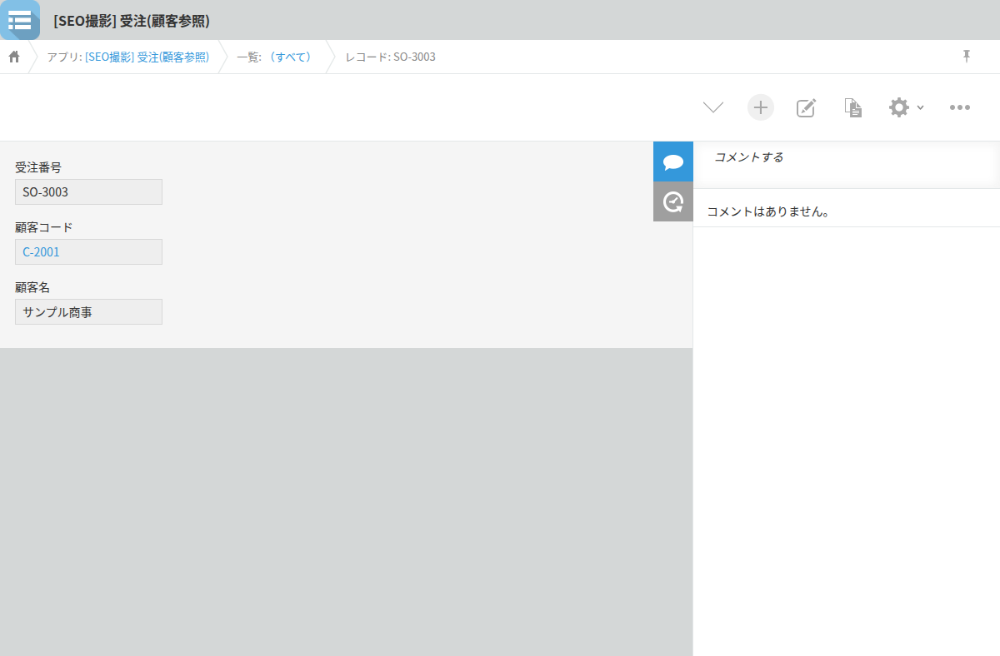
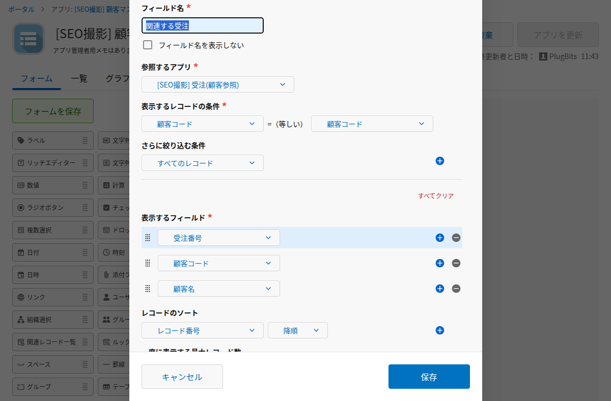

A kintone Lookup field automatically adds a link to the record it pulls data from. Click the customer code on an Orders record, and the matching record in the Customer master opens right away. No setup is needed for that direction. But there is no built-in way to get back from the Customer master to the original Orders record. To build a path back, you need to set up a Related Records field ahead of time, and even then it only gives you a list view, not a direct link to one record.

This is for kintone admins running apps that span multiple apps, such as Orders, a Customer master, and a Parts master.

## Lookup links only go one way

When a Lookup field pulls in a value, that value automatically becomes a link to the record it came from in the referenced app. Click the copied field, and the single matching record in the referenced app opens directly.

This is built into kintone and starts working as soon as you set up a Lookup field. No extra configuration is required. It covers moves like going from a customer code on an Orders record to the Customer master, or from a part number on a Quotes record to the Parts master.

If a one-way trip is all you need, this is enough. If you only need to check a value and don't need to come back, the standard link causes no trouble.

The trouble starts when you notice something while you're there and need to go back and fix the original record. At that point, you're outside what kintone provides out of the box. Your options are the browser's back button or searching again from scratch.

## Getting back relies on Related Records, which needs setup and a matching condition

To build a path back using standard kintone, add a Related Records field on the Customer master side. This field displays, as a list, the records in another app whose field value matches a field in the current app.

If the Customer master has a Related Records field such as "Orders for this customer," opening a record shows the linked orders as a list. As long as the app administrator has set this up in advance and the target app and condition are fixed, this is enough.

However, it is a list view, and you can only open one record at a time by clicking into it. Every time you add another app to reference, you need to revisit the condition. And for any combination of apps where no Related Records field exists, this path isn't available at all.

## Building a "recently opened records" feature, and barely using it

To make it easier to move across multiple apps, a side panel feature called "Recently opened records" was built into a Chrome extension. It lists records opened recently, across different apps, in one place.

Looking back after shipping it, this list turned out to be opened only rarely. The reason was that when the moment came to go back, this list wasn't what came to mind. The details are written up in the note article "What I use every day in my own kintone extension, and the screen I stopped opening" (2026-09-28, https://note.com/plugbits/n/n998e60ca4337).

For someone whose job involves returning to the same record over and over, this kind of feature should still be useful. But in practice, what actually happened at the moment of wanting to go back was typing part of an app name into a command palette and searching again from there.

Building a list doesn't guarantee your hand will reach for it the moment you need it. Rather than adding a feature for frequent back-and-forth moves, a way to go back that requires remembering nothing at all turned out to be the better fit.

