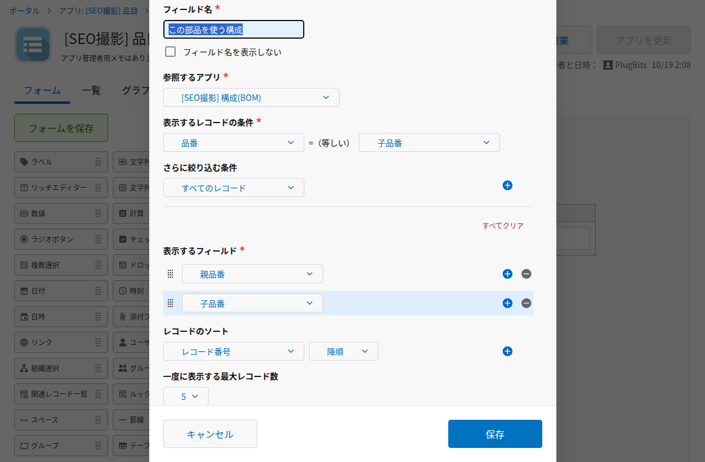

You can build a bill of materials (BOM) in kintone with standard features: tables (subtables), Lookup and Related records. That covers a single-level parent-child structure. Once you add parts within parts (a second level or deeper), two things start to need manual work: viewing every level together, and multiplying and totaling quantities across levels.

## What a Standard kintone App Can Handle (Tables)

For a single-level BOM, a table (subtable) inside your Item app is enough. Because a table lets a single record hold multiple line items, opening the record for a finished product shows every part it uses, each with a quantity, in one table. Set the child part number field as a Lookup field, and kintone pulls the part name and unit from the Item master instead of making someone type them in every time. For a shop floor where the parent-child relationship is a single level and the structure rarely changes, this is enough to run day-to-day operations.

 on an Item app")

## Splitting Parent and Child Items into Two Apps

When the same part is shared across multiple parent products, it holds up better to split the Item app and a separate BOM app apart. With a single table, there's no way to look up, from the Item side, which parent products use that part and in what quantity. Build the BOM app so each record is one line, parent part number by child part number by quantity, and connect both part number fields to the Item app with Lookup fields. Then the Item app's record details screen can use a Related Records field to show every BOM line that uses that part. If parts get reused across multiple products, this two-app structure is easier to maintain down the road.

## Count How Many BOM Levels You Actually Have First

Before setting up a BOM in kintone, it's worth counting how many levels your current bill of materials actually has. Whether a single level is enough, or whether you need two or three levels (finished product to unit to part), changes which structure to build. This mirrors how many manufacturers first turn to kintone: to build out their own production management, as described in [this account of why a manufacturing GM started building kintone plug-ins](https://note.com/plugbits/n/n9ddb45afa0da). Counting how many levels the current structure actually has, rather than committing to a perfect design from the start, is the more direct path to setting up a BOM in kintone.

## Where Multi-Level BOMs (Parts Within Parts) Hit a Wall

Once a BOM goes past two levels, standard features start to fall short. Say a finished product needs 3 units of Part A, and Part A needs 2 units of Part B: there's no field that automatically calculates how many units of Part B are needed for 10 finished products (60 units) — someone has to trace the related records and multiply it out by hand. If the same part is used through more than one path in the structure, adding up the totals across those paths takes extra work too. On top of that, a part name or unit price copied once through a Lookup field does not update automatically when the master record changes. Past two levels, kintone's standard features can store a multi-level BOM, but calculating quantities across levels still falls to a person.
