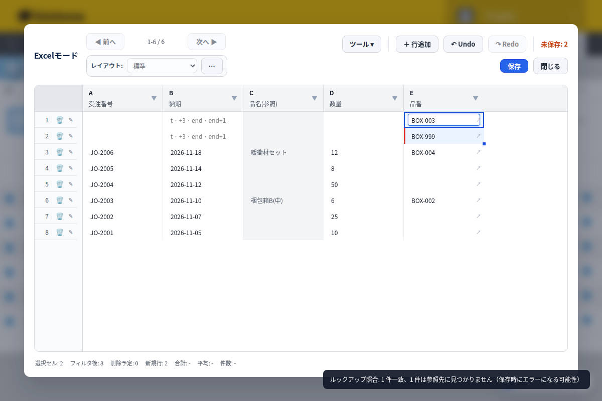

Adding a record in kintone's standard app is a one-record-at-a-time operation. After you save, you land back on the record details screen, and to add the next one you have to press "Create" again from the start. There is no built-in feature that automatically opens a new, blank record right after you save. The free Quick New Record feature speeds up entering a single record, and the paid Grid Edit lets you add rows and save several records at once.

## The standard app: one record at a time, press "Create" again after every save

With kintone's standard functionality, saving one record sends you back to the record details screen, and starting the next one means pressing the "Create" icon again. The official kintone help only describes adding records one by one, and for multiple records it points you to importing from Excel or CSV. If you only add a handful of records, this isn't a big deal. But in scenarios like order entry or inspection logs, where dozens of records go in every day, every extra click adds up to real time.

## Speed up a single record by showing only the fields you need

Quick New Record, a feature in the PlugBits Launcher Chrome extension, opens an entry screen with only the fields you choose, without leaving the list view. The shortcut is Shift+Alt+N. The standard form is built for everyone who touches the app, so it tends to carry a lot of fields, but any one person usually only fills in a subset of them. Quick New Record lets you pick just the fields you need and arrange them in your own order, cutting down on the clicks per record. You're still entering records one at a time, but with less time spent hunting for the right field, which makes the work noticeably lighter. This feature is free to use.

## Add several rows and save them all at once

When you need to add many records at once, Grid Edit (Pro) opens the list view as a spreadsheet-style table, where you can add rows and type directly, or paste data in from Excel and save it all in bulk. Lookup columns are checked automatically against the reference app, showing green for a match and red for a mismatch, so you can catch errors before you save. It's a one-time purchase of ¥1,980 with a 14-day free trial, not a monthly subscription. For a few records entered here and there throughout the day, Quick New Record is enough; when you want to enter several records at once, Grid Edit is the better fit.

## What too many fields on the form taught us about building Quick New Record

While managing several kintone apps, it became clear that a crowded entry form was the real source of friction in continuous data entry. Apps for orders and inspection logs tend to accumulate fields for every stakeholder, so entering a single record meant spending time hunting through the screen for the fields that actually mattered. The fix was an entry screen that shows only the fields actually used, arranged in a chosen order and opened with Shift+Alt+N (background: https://note.com/plugbits/n/nc648a8a99f2e). The more fields an app has, the more a faster single-record entry screen cuts down the overall burden of continuous data entry.

Quick New Record is part of PlugBits Launcher, a free Chrome extension. When you need to add rows and save several records at once, Grid Edit Pro, part of the same extension, is built for that.

