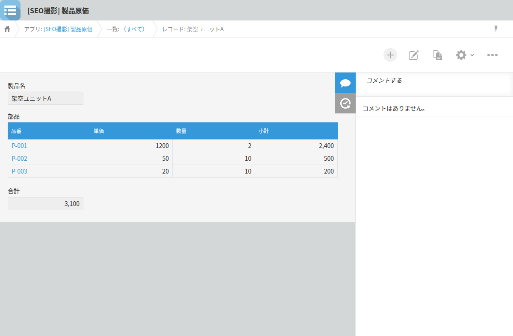
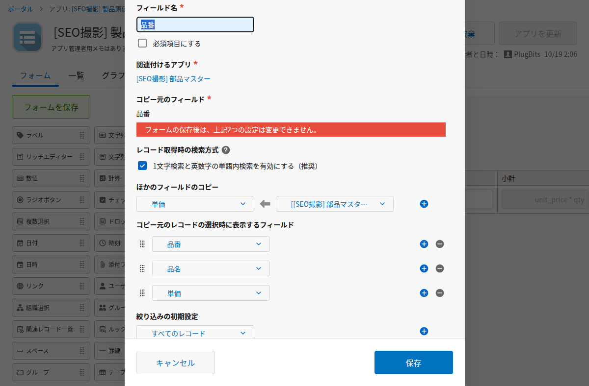

kintone's standard features — Calculated fields, Lookup, and tables (subtables) — can handle a fair amount of cost calculation. If you only need a single-level roll-up, such as listing materials or process steps in a table and summing them, or pulling a part's unit price from another app with Lookup, standard features are enough. Where it breaks down is when a part itself is made up of other parts, and you want kintone to automatically roll up costs through a multi-level bill of materials (BOM), no matter how many levels deep it goes.

## If you only need to total material and process costs at one level, standard features are enough

List part or process rows in a table, use a Calculated field to multiply each row's unit price by quantity for a subtotal, and use SUM(subtotal) outside the table to total it. That gets you the full cost for one record. For part unit prices, set up a Lookup field pointing to a parts master app and the price gets copied in by key. For a simple product with only materials and outsourcing costs, and only one type of process, this setup is all you need.

## Standard features alone can't roll up costs through a multi-level BOM where parts contain parts

There is no standard-features way to automatically walk through multiple levels of a bill of materials when a child part is also made in-house and has its own BOM (2026 October).

There are two reasons for this. First, a Lookup field does not update automatically when the source record it references changes. According to kintone's official help, a value copied in by Lookup stays as it was copied and is not automatically refreshed to the source record's latest value — it stays outdated until you trigger the lookup again. Second, Lookup's copy source field setting cannot reference a field that is inside a table.

If you correct the cost of a bottom-level part, that change doesn't propagate up to its parent, or further up to its grandparent. You'd need to manually re-trigger the Lookup at each level and work your way up from the bottom, one level at a time. Get the order wrong, and an outdated cost can stay baked into the total without anyone noticing. There's also no mechanism to detect a circular reference in the structure (for example, A references B, B references C, and C loops back to A). For a BOM with only two levels and costs that rarely change, manual updates are workable. For three or more levels, or costs that change often, this approach runs into trouble.

## Breaking costs down level by level surfaces waste that totals alone hide

In a past turnaround of a small manufacturing shop, breaking down the daily work order records line by line uncovered a problem: machining work that could have been done in-house was routinely being sent out to a subcontractor. Because in-house labor costs are paid whether or not there's work to do, outsourcing it meant paying for that labor twice. This double payment was buried in the totals until each work order record was reviewed individually.
Details: https://note.com/plugbits/n/nffcd9c3e3f56

Looking only at the total number won't show you which level the cost is ballooning at. Only by breaking the total down level by level can you find where the waste actually is.

## Where standard features stop being enough

If your bill of materials is only one or two levels deep and changes infrequently, the combination of Calculated fields, Lookup, and tables will get the job done. If parts contain other parts, costs change frequently, and you need an automatic roll-up across many levels, you're past what standard features can do. Start by counting how many levels deep your current bill of materials actually goes, and how often unit prices change.
