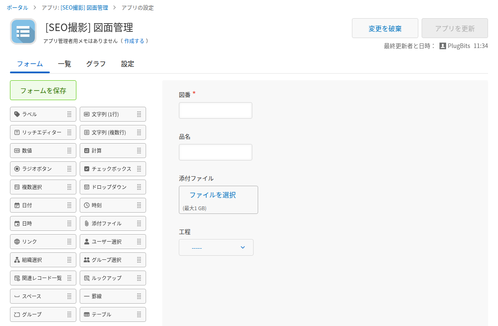
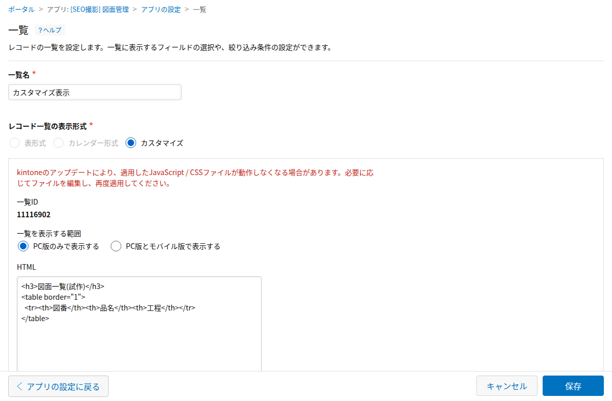

People searching for "kintone drawing management" are usually trying to answer one question: what fields should the app have, and how do you make the list view easy to search? The short answer is that four standard fields are enough for the data model, and you can change the shape of the list view with the "Customize" view type. Where the standard view type falls short is laying out drawings as images you can browse, which takes extra work beyond what "Customize" gives you out of the box.

## Start with Just Four Fields

An app for storing drawings only needs four fields to get going: drawing number, item name, attachment, and process (a drop-down or radio button field). Every extra field you add makes data entry more work, and in practice that means records stop getting filled in. Make any field you'll use for filtering a drop-down or radio button field instead of free text, so inconsistent spelling doesn't break your filters.

You can add fields like material or dimensions at any time later. Starting with four fields and finding out what's missing once the app is in use gets you to a working app faster.

## Changing How the List View Looks

kintone list views come in three types: Table, Calendar, and Customize. A list that only shows text like the drawing number and item name doesn't help people on the shop floor find the drawing they need, because they remember drawings by shape, not by drawing number.

The "Customize" view type lets you build the list layout freely with HTML, but according to kintone's official help, it does not support JavaScript code. If you want to lay out attached images as a tile gallery, HTML alone doesn't get you there, and it takes additional customization to make that work. It helps to be clear about where standard settings end and where extra work begins.

## A Design That Held Up After Managing 4,616 Drawings

One case covers putting 4,616 drawings into kintone and running the app in production, from the field design through how the list view is presented. The full details are in that article:

- "A First Design Pattern for Managing Drawings in kintone" (2026-09-13) https://note.com/plugbits/n/n694a02029993

## When Fields and List View Still Aren't Enough

Fields and a list view alone don't get you all the way to "finding a similar drawing by shape." People on the shop floor rely on the shape of a drawing, not the drawing number, and text-based filtering only goes so far.

A related article that looks at the same problem from a different angle is "Four Years Ago, a Machine Shop Was Looking for a Drawing" (2026-08-12) https://note.com/plugbits/n/nc95e319920d4. PlugBits Drawing, a drawing similarity search service, ended service in October 2026 (the background is covered in "Four Weeks After Launch, Zero Signups: Why We Shut Down Our Drawing Search Service" https://note.com/plugbits/n/ndd205c0c8979), so there is currently no tool to recommend for this.

Getting the standard fields and list view design right is worth doing on its own. Going beyond that level of searchability is a separate question.
