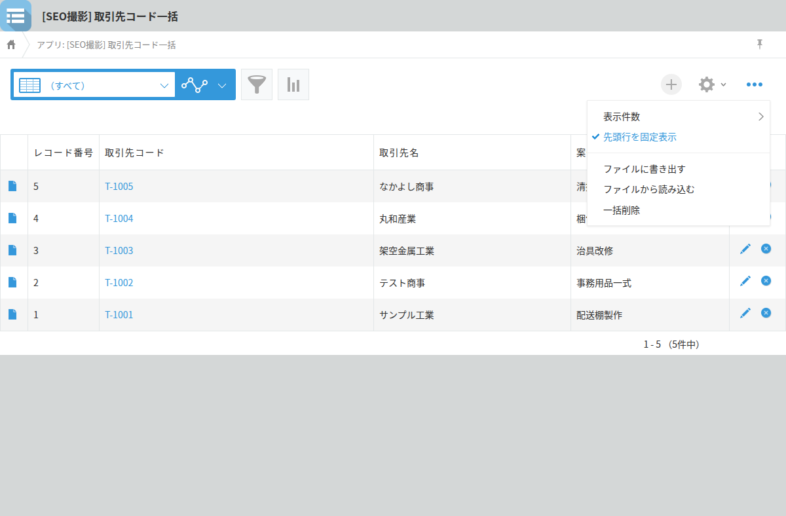
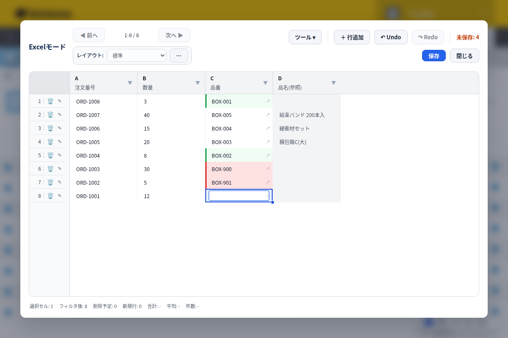

kintone's record list screen has no feature for rewriting field values in bulk. The list view's "Options" menu doesn't include a bulk-edit item—the only bulk operation available is bulk deletion, and it's turned off by default. Importing a CSV file lets you include Lookup fields among the fields you update, but if the Lookup's source app has more than one record with the same value, that row fails to import. If opening and fixing records one at a time has gotten tiresome, here's what standard kintone can and can't do.

## Bulk operations in the list view mean deletion, not editing

kintone's record list screen has no feature for rewriting values in bulk; the only operation actually labeled "bulk" is bulk deletion. When an app administrator turns on "Enable bulk record deletion" in the app settings, a bulk-delete option appears in the list view's "Options" menu, and up to 50,000 records can be deleted at once while any filter you've applied stays in effect.
This feature exists only to remove records, though—there's no bulk-edit option for rewriting values. If the goal is just to fix Lookup keys or standardize how product codes are written, the list screen simply has no tool for that.
The next option worth considering is updating records through a CSV import.

## Updating Lookup fields via CSV comes with one condition

When you update records through a CSV import, you specify which records to update using an update key, and each column in the file loads into the field whose name matches the column header. With the current standard import method, added in August 2024, Lookup fields can be included as import targets even when the Lookup's source field doesn't have "Prohibit duplicate values" turned on.
One condition remains, though: if more than one record in the source app matches the value being imported, kintone has no way to decide which one to use, and that row alone fails with an error. This tends to come up in workflows that reuse customer codes or product codes, and it's usually something you only discover after running the import.
If the values in the Lookup's source app are close to unique, a CSV update is enough on its own. If the data includes values that collide, there's still the extra step of reviewing the failed rows and fixing them one by one.

## Check your Lookup's source data before attempting a bulk update

Checking the Lookup's source values ahead of time gives a reasonable estimate of whether a CSV update will go through cleanly. For the key field being updated, sort the source app's list view by that field and check whether the same value shows up on consecutive rows—that's the entire check.
Only the duplicated values are candidates for an import error. If there are no duplicates, the import will succeed; if there are, counting them first tells you whether you're looking at a handful of failures or one that fails across the board.
This check only requires sorting the source app's list view, so it's fully doable with standard kintone features. If the number of duplicates is large and the manual follow-up work needs to be cut down, it's worth considering a tool built for editing the list view directly.

If the goal is to rewrite Lookup keys directly in the list view and check them against the source app on the spot, Grid Edit Pro from PlugBits Launcher supports that.

