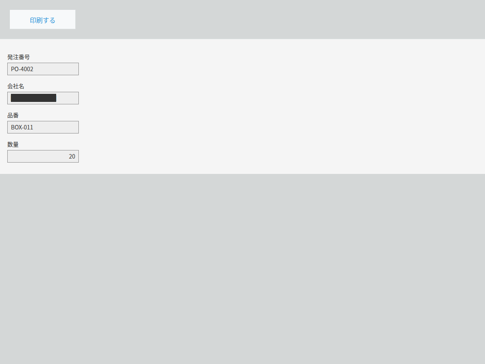
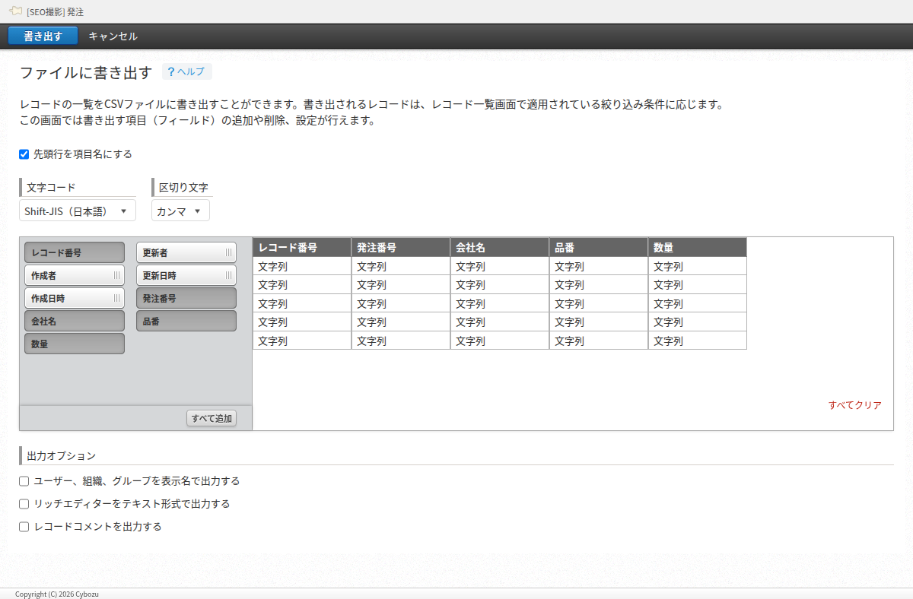

When you need to create a purchase order in kintone, the standard functionality gives you two options: printing a record from the record details screen, and exporting a list view to CSV to open in Excel. Neither one produces the fixed layout that a purchase order sent to a vendor needs. To issue multiple purchase orders at once in a proper format, you need something beyond these two standard tools.

## Print Record doesn't produce a purchase order layout

The record details screen includes a Print Record feature. For an internal copy you keep for your own records, this may be enough. But what gets printed is simply a list of field names and their values — it doesn't match the layout a vendor expects from a purchase order. As of October 2026, the official kintone help documentation doesn't describe any way to customize this print layout. Checking the content of a single record is about as far as the standard feature goes.

## CSV export to Excel still means pasting records one by one

The other standard option is exporting a list view to a CSV file. You can choose which fields to include, the character encoding, and the delimiter, so the data itself comes out accurately. The official kintone help documentation also describes this export as a way to analyze and aggregate data, not to generate formatted documents. The exported file isn't in the shape of a purchase order on its own. To turn it into one, someone still has to paste each record's values into an Excel template by hand, one at a time. For a handful of orders a month, that's manageable. But as the number of orders grows, that manual work adds up directly, and there's no built-in way to catch a mistake before the order goes out.

## What tracking outsourced work revealed about purchase records

There's a related lesson about purchasing itself. A note published by PlugBits describes a small factory that had been running at a loss, where a later review of costs showed that work the shop could have handled internally was instead being sent out to a subcontractor — meaning some costs were effectively being paid twice (https://note.com/plugbits/n/nffcd9c3e3f56). That review was only possible because records of each order placed with the subcontractor had been kept one by one. A system for issuing purchase orders ends up being a system for keeping records, too — and those records are what make a cost review possible later.

## How to batch-generate purchase orders in a proper format

When the two standard options above aren't enough, one approach is to merge selected records into an Excel template and generate all of them as a batch. Values are filled into `{fieldCode}` placeholders in the template, and each record is added one after another within a single file, so printing everything takes just one Ctrl+P. This is what Excel Report Batch Generator does.
