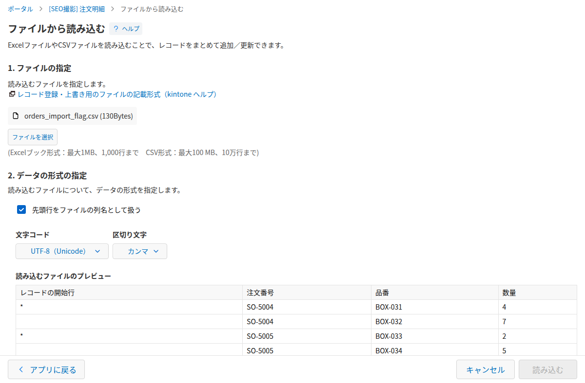
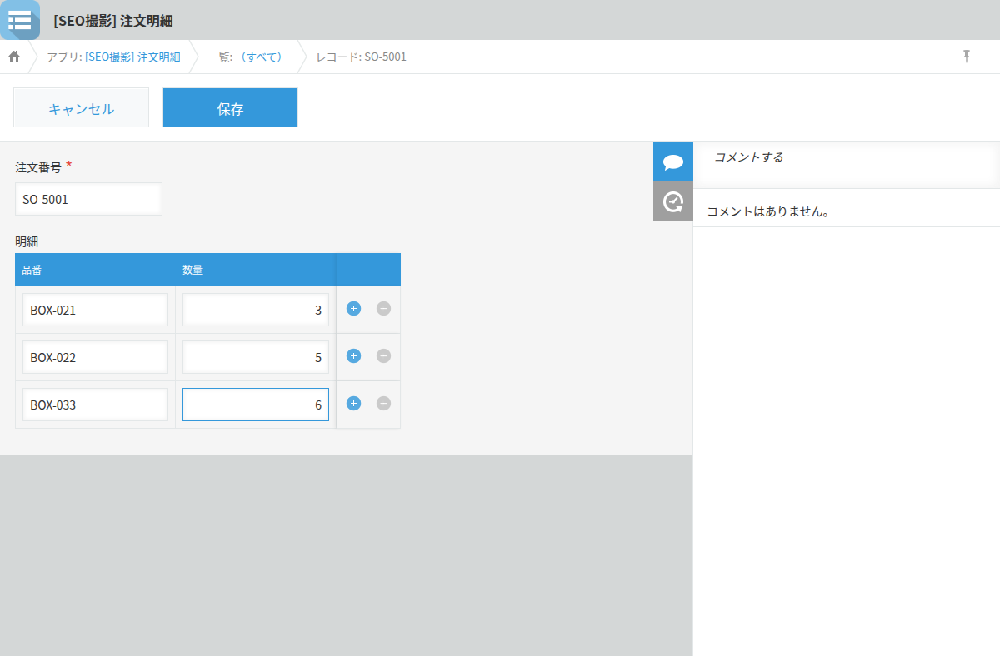

If you want to add a batch of Excel rows into a kintone table (subtable), you can use the standard **Import file** feature. As of October 2026, the official kintone help does not document a way to paste a block of Excel cells directly into the record edit screen. If you have a large number of rows, it's more practical to format a file and import it; for just a few rows, adding them one at a time in the record edit screen is the realistic option.

## Using the standard Import file feature to add table rows

Apps that include a table (subtable) can still add or update records from a CSV or Excel file. kintone's **Import file** feature supports apps with tables, and kintone provides a specific file format for this purpose. When importing, each record uses as many file rows as it has table rows, and a marker in the first column shows where each new record starts. If your columns are consistent and you have a good number of rows to bring in, this method is reliable. But if you only receive a handful of rows trickling in every day, building a file each time can feel like more trouble than it's worth. Start by checking whether the standard import fits your case, then build the file to match the required format.

## Writing the new record flag (*) to group table rows

The first column holds a marker (*) that shows where a new record starts. Since table rows are laid out as individual file rows, you need some way to indicate where one record ends and the next begins. Put an asterisk in the first column of the first row, and fill in the other fields on that same row. For the rows that follow, leave the first column blank and fill in only the table fields. If an app has more than one table, mixing values from two different tables on the same row causes an error, so keep each table's rows on their own rows. If the marker is placed incorrectly, the grouping shifts and values end up attached to the wrong record — so for a small number of fixes, entering data directly on screen is safer.

## Can you paste Excel data directly into the record edit screen?

The official kintone help on tables only goes as far as saying you can add or delete table (subtable) rows; it doesn't describe pasting a range of Excel cells at once (as of October 2026). For just a few rows, adding a row and pasting one cell at a time is enough. If you need to move multiple rows and columns at once, rely on the standard file import rather than pasting on screen.

## Checking whether your current tools support range paste

If you're using a browser extension or customization, you can check whether it supports range paste into a table by trying to drag-select multiple cells on your own screen. In the record edit screen, try clicking and dragging with the mouse to see if you can select several cells at once. If only a single cell can be selected, range paste isn't supported. If your volume of rows is small enough that adding a row and pasting one cell at a time still works for you, there's no need to look for another tool.
