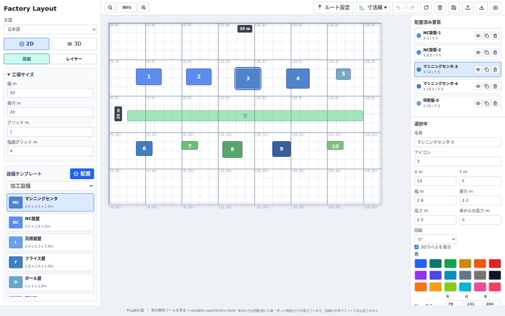

Excelでも、セルを正方形にして方眼紙のように使い、図形で設備を置けば、工場のレイアウト図は描ける。ただし、実寸と縮尺の扱いは自分で決める必要があり、設備が増えるほど動作が重くなるという限界もある。最初の叩き台には向いていて、規模が大きくなったときに別の手段を考える、という使い分けになる。

## セルを正方形にして、図形で設備を置く

描き方の基本は、シート全体を選んで列幅と行の高さを同じ値にそろえ、方眼にすることだ。レイアウト作成を紹介するat-officeの記事は、セルを方眼紙のように正方形に設定すると、位置関係を表しやすいと説明している。そのうえで、［挿入］タブの図形で四角形や線を描き、柱や扉も加えていく。なお、この記事の対象はオフィスのレイアウトで、工場の話ではない。

## 縮尺は自分で決める

Excelの列幅と行の高さは、実寸ではない単位で決まる。Microsoftのサポートページには「列の幅は、文字単位 (セル内に収まる既定のフォントの文字数) で測定されます。」「行の高さはポイント単位で測定されます。」とある。そのため、図の寸法を実際の長さに合わせるなら、1マスを何メートルにするかを先に決めて、設備の大きさをマス数に直して置くことになる。ページレイアウト表示ならcmやmmで入力できると、at-officeの記事は案内している。

## 設備が増えると重くなった

自社でも、工場のレイアウト検討にExcelを使っていた。セルを方眼紙のように使い、設備や通路を四角形で並べるやり方だ。レイアウトの規模が大きくなるほど作成に時間がかかり、四角形が増えてシートが大きくなると、スクロールにも引っかかりを感じるようになった。配置は検討しながら何度も直すため、重さが一番の悩みになった。経緯は自社blogの[工場レイアウトをExcelで作っていた頃の話](https://plugbits.app/blog/factory-layout/)にまとめている。

## 小さな図はExcel、大きくなってきたら別の道具も

設備が数台の簡単な配置なら、Excelで十分に叩き台が作れる。at-officeの記事も、簡易的な図面で足りるならまずExcelで叩き台を作るのが有効だとし、細部まで表すなら専用のソフトのほうがよいと述べている。設備が増えて重くなってきた場合の選択肢として、ブラウザで使うFactory Layout Plannerがある。設備テンプレートを置き、寸法や回転をグリッド上で決める2D配置のほか、3Dでの表示、歩く視点での確認、ノート、PNGの書き出し、ファイルへの保存と読み込みができる。Excelの図と併用して、配置を試す場として使う方法もある。

