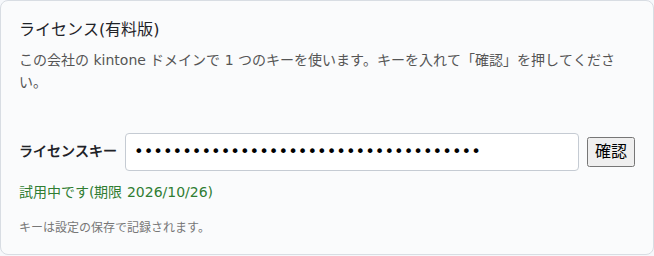
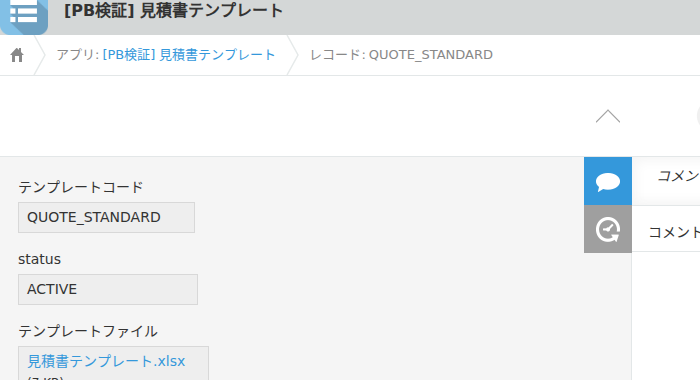
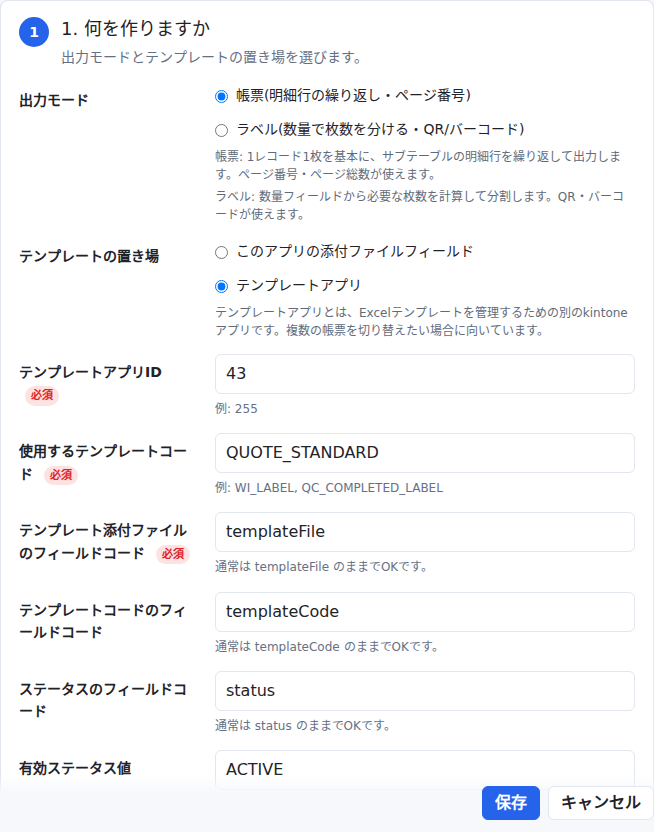
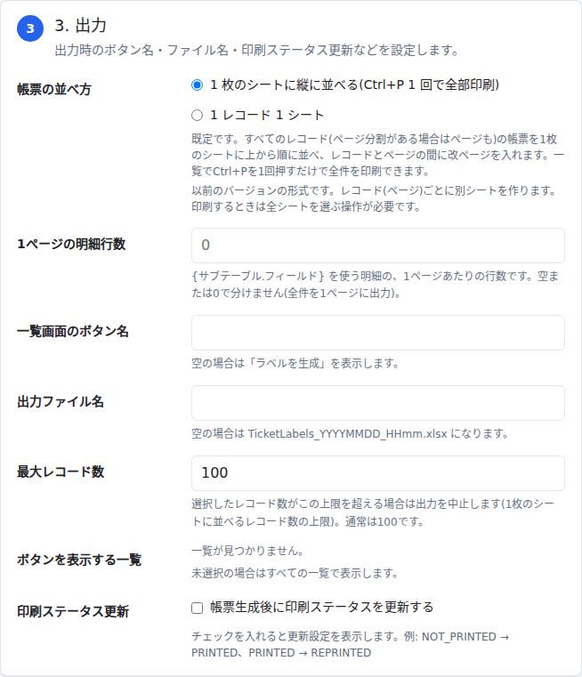
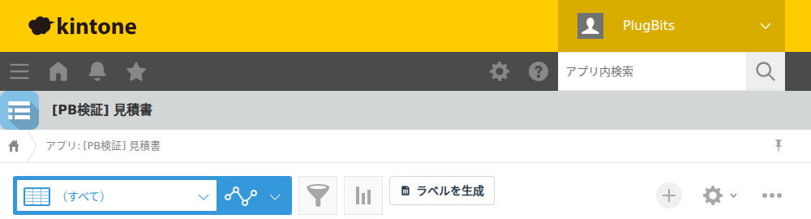

kintoneの一覧レコードをExcelテンプレートへ差し込み、xlsx帳票を一括生成するプラグインです。既定では選択したレコードを1枚のシートに縦に並べて出力します(1レコード1シートに切り替えることもできます)。

## 1. できること

- 一覧画面でレコードを選び、ボタン1つでExcelテンプレートへ値を差し込んで一括生成します。
- 出力モードは2つあります。
  - **帳票モード**: 1レコード1枚を基本に、サブテーブルの明細行をテンプレート上で繰り返して出力します。ページ番号・ページ総数が使えます(見積書・請求書・作業指示書などの帳票向け)。
  - **ラベルモード**: 数量フィールドから必要な枚数を計算して分割します。QR・バーコードが使えます(現品票・ラベルシール向け)。
- 既定の出力は「1枚のシートに縦に並べる(Ctrl+P 1回で全部印刷)」です。レコード(またはページ)の境目には自動で改ページが入るので、一覧でCtrl+Pを1回押すだけで選んだ全件を印刷できます。従来どおり「1レコード1シート」に分けることもできます。

## 2. 動作環境

PCのブラウザ(Chrome/Edge 最新版)での利用を前提としています。kintoneモバイル(スマホアプリ・モバイル版画面)には対応していません。

## 3. 対応版

このマニュアルは **バージョン 2.1.0** の内容です。

## 4. ライセンス(試用と購入)

有料版のプラグインです。設定画面の一番上に「ライセンス(有料版)」欄があります。

- **試用**: 「14日間 無料で試す」ボタンを押すと試用が始まり、キーが自動で入力されます(「試用を始めました。キーは自動で入りました。設定を保存してください。」というメッセージが出るので、そのあと画面下部の「保存」を押してください)。試用は **kintoneドメイン(会社)ごとに1回・14日間** までです。試用中は「試用中です(期限 YYYY/MM/DD)」と表示されます。
- **購入したキーを使う場合**: 「ライセンスキー」欄に購入したキーを入力し、「確認」を押してから「保存」します。
- **2 つ目以降のアプリ**: 同じ kintone ドメインの 2 つ目以降のアプリでは、キーを入れなくても使えます(どれか 1 つのアプリでキーを確認するか試用を始めれば、設定画面に「このドメインで有効です」と出ます)。
- **購入ページ**: https://plugbits.app/kintone/kintone-excel-report/(購入の手続き: https://buy.stripe.com/7sY9AV2vJgbofFm5N38so04)
- **利用規約**: https://plugbits.app/kintone/terms/
- **期限切れ・未登録のとき**: ライセンスキーが未登録、または試用・購入期限が切れると、一覧画面・詳細画面側の機能(ボタン表示や出力)が止まります。画面右下に「(プラグイン名): ライセンスが未登録か期限切れのため停止しています。管理者の方はプラグインの設定画面から登録してください。」という案内が表示されます(×で閉じられますが、機能自体は止まったままです)。管理者はプラグインの設定画面からキーを登録し直し、保存・アプリの更新を行ってください。

## 5. 設定画面の開き方

1. 対象アプリ(Excelを出力したいレコードが入っているアプリ)を開きます。
2. アプリ設定を開きます。
3. 「プラグイン」を開き、「Excel帳票一括生成」の設定アイコン(歯車)をクリックします。

## 6. テンプレートを準備する

### 6-1. テンプレートの置き場

設定画面の「1. 何を作りますか」で、テンプレートの置き場を3つから選びます。

| 置き場 | 内容 |
| --- | --- |
| テンプレートアプリ(推奨) | Excelテンプレートを管理するための別のkintoneアプリから読み込みます。複数の帳票を切り替えたい場合に向いています。 |
| このアプリの添付ファイルフィールド | 出力対象アプリの各レコードにテンプレートを添付して使います。レコードごとに違うテンプレートを使いたい場合に向いています。 |
| 固定URL(旧設定) | 以前のバージョンで固定URLを設定していたアプリにのみ表示されます。新規設定では選べません。 |

**テンプレートアプリ**を選んだ場合は、次の項目を入力します(通常は既定値のままでOKです)。

| 設定項目 | 内容 | 既定値 |
| --- | --- | --- |
| テンプレートアプリID | テンプレートを管理しているアプリのID | (必須・例: 255) |
| 使用するテンプレートコード | 使うテンプレートを識別するコード | (必須・例: WI_LABEL) |
| テンプレート添付ファイルのフィールドコード | テンプレートアプリ側の添付ファイルフィールド | `templateFile` |
| テンプレートコードのフィールドコード | テンプレートアプリ側のコード用フィールド | `templateCode` |
| ステータスのフィールドコード | 有効/無効を判定するフィールド | `status` |
| 有効ステータス値 | このテンプレートコードが「使える」とみなす値 | `ACTIVE` |

**テンプレートアプリの例**(社内の検証環境「見積書テンプレート」アプリ):

このように、テンプレートアプリには1レコードにつき1テンプレートを登録します。`templateCode`(例: `QUOTE_STANDARD`)・`status`(`ACTIVE`)・`templateFile`(Excelファイルの添付)の3項目があれば動きます。帳票用とラベル用など、複数のテンプレートを別レコードとして登録しておき、出力対象アプリ側でどのコードを使うかを設定します。

### 6-2. 差し込みタグの書き方

Excelテンプレートのセルに、差し込みたい場所をタグとして書き込みます。書き方は新旧2種類あり、どちらも使えます。

**新しい書き方(推奨: 単一の波括弧)**

| 書き方 | 意味 |
| --- | --- |
| `{フィールドコード}` | そのレコードの値をそのまま差し込みます。例: `{顧客名}` `{件名}` `{見積日}` `{合計}` |
| `{サブテーブル.フィールド}` | 明細行です。この書き方を含む行があると、その行が「明細行」として自動認識され、サブテーブルの行数ぶんだけ下に繰り返されます。例: `{明細.品名}` `{明細.数量}` `{明細.単価}` `{明細.金額}` |
| `{detailNo}` | 明細行の通し番号(1始まり)が自動で入ります。 |

明細行は、連続した行のどこかに `{サブテーブル.フィールド}` があれば、その行の塊ごと繰り返されます。繰り返しに合わせて、下にある合計行などの結合セル・印刷範囲・改ページ・画像も自動で下へずれます。{ }の中身が知らない名前の場合は、何もせずそのまま文字として残ります(テンプレートが壊れることはありません)。

QR画像・バーコードは、単一の波括弧(`{QR:タグ}` など)には対応していません。**必ず二重波括弧(`{{QR:タグ}}` `{{BC:タグ}}`)で書いてください**(下の「もう一つの書き方」を参照)。

**もう一つの書き方(二重波括弧)**

| 書き方 | 意味 |
| --- | --- |
| `{{タグ}}` | 設定画面の「差し込み項目」の対応表でフィールドや自動生成値に変換します。例: `{{partNumber}}` |
| `{{QR:タグ}}` / `{{BC:タグ}}` | QR画像・バーコード画像 |

`{{タグ}}` の書き方は、ラベルモードと、以前から使っているテンプレートのためのものです。新規にテンプレートを作る場合は、新しい `{フィールドコード}` の書き方をおすすめします。

### 6-3. テンプレートの作り方の例

社内の検証環境にある「見積書テンプレート.xlsx」を例に説明します(この例は帳票モード・1枚のシートに縦に並べる既定出力で使っています)。

| 行/セル | 内容 |
| --- | --- |
| A1:E1(結合) | タイトル「御見積書」 |
| A3:C3(結合) | 宛先「`{顧客名}` 御中」 |
| D3:E3(結合) | 日付「見積日: `{見積日}`」 |
| A4:E4(結合) | 件名「件名: `{件名}`」 |
| 5行目 | 明細の見出し行「No. / 品名 / 数量 / 単価 / 金額」 |
| 6行目(繰り返し対象) | 明細行「`{detailNo}` / `{明細.品名}` / `{明細.数量}` / `{明細.単価}` / `{明細.金額}`」 |
| 7行目 | 合計行「合計 / `{合計}`」 |

ポイントは6行目だけです。この行に `{明細.品名}` のような `{サブテーブル.フィールド}` を書いておくと、レコードの明細(サブテーブル)が何行あっても、その行数ぶんだけ自動で複製されます。7行目の合計行は、明細が増えた分だけ自動で下にずれるので、テンプレート側で明細の行数を気にして作る必要はありません。印刷範囲もテンプレートの印刷範囲設定に合わせて自動調整されます。

同じ要領で、ラベルモード用に小さいラベル(品番・数量・QRなど)だけのシンプルなテンプレートを作ることもできます。

## 7. 設定1: 何を作りますか(出力モードとテンプレートの置き場)

- **出力モード**
  - 「帳票(明細行の繰り返し・ページ番号)」: 既定です。1レコード1枚を基本に、サブテーブルの明細行を繰り返して出力します。
  - 「ラベル(数量で枚数を分ける・QR/バーコード)」: 数量フィールドから必要な枚数を計算して分割します。QR・バーコードが使えます。
- **テンプレートの置き場**: 「6-1. テンプレートの置き場」のとおりです。

## 8. 設定2: テンプレートと項目の対応を確認

設定を入力したら、テンプレートの差し込みタグがすべて正しく対応しているかをこの画面で確認できます。

1. 「手元のExcelを選んで確認」でローカルのxlsxファイルを選ぶか、「テンプレートアプリから読み込んで確認」でテンプレートアプリ側のファイルを読み込みます(選んだファイルはブラウザの中だけで読み込まれ、どこにも送信されません)。
2. シート名!セル番地・書いてある差し込み・対応先・状態(✓ / ⚠ 見つかりません)の一覧表が表示されます。
3. 「⚠ 見つかりません」が出た項目は、Excel側のタグ名と設定画面側の対応がずれています。

画面下の「このアプリのフィールドコード(コピー用)」を開くと、このアプリのフィールドコード一覧が表示され、クリックすると `{フィールドコード}` の形でコピーできます。Excelテンプレートに貼り付けて使えます。

## 9. 設定3: 出力

- **帳票の並べ方**
  - 「1枚のシートに縦に並べる(Ctrl+P 1回で全部印刷)」: **既定**です。すべてのレコード(ページ分割がある場合はページも)の帳票を1枚のシートに上から順に並べ、レコードとページの間に改ページを入れます。一覧でCtrl+Pを1回押すだけで全件を印刷できます。
  - 「1レコード1シート」: 以前のバージョンの形式です。レコード(ページ)ごとに別シートを作ります。印刷するときは全シートを選ぶ操作が必要です。
- **1ページの明細行数**: `{サブテーブル.フィールド}` を使う明細の、1ページあたりの行数です。空または0の場合は分けません(全件を1ページに出力)。
- **一覧画面のボタン名**: 空の場合は「ラベルを生成」と表示します。
- **出力ファイル名**: 空の場合は `TicketLabels_YYYYMMDD_HHmm.xlsx` になります。
- **最大シート数(最大レコード数)**: 選択件数がこの上限を超える場合は出力を中止します。既定は100です。
- **ボタンを表示する一覧**: 未選択の場合はすべての一覧に表示します。
- **印刷ステータス更新**: オンにすると、出力後にレコードを更新できます。印刷ステータスフィールド・初回印刷後の値(既定 `PRINTED`)・再印刷後の値(既定 `REPRINTED`)・印刷日時フィールド(任意)・印刷者フィールド(任意。USER_SELECTフィールドにはログインユーザー、それ以外のフィールドにはユーザー名が入ります)を設定します。現在値がすでに `PRINTED` / `REPRINTED` の場合は次回出力時に `REPRINTED` が入り、それ以外の場合は `PRINTED` が入ります。

## 10. ラベルモードの追加設定(ラベル枚数設定)

出力モードで「ラベル」を選んだときだけ、「1. 何を作りますか」の下に「ラベル枚数設定」が表示されます。

1レコードから複数枚のラベルを作りたい場合に、「数量に応じてラベルを複数枚作成する」をオンにして次を設定します。

| 設定項目 | 内容 | 既定値 |
| --- | --- | --- |
| 全体数量のフィールド | 総数量が入っているフィールド(「Plan: 100」のような文字列でも数値部分を読み取ります) | (必須) |
| 1ラベルあたりの数量フィールド | 1枚あたりの数量が入っているフィールド | (必須) |
| ラベル数量タグ名 | Excel側で `{labelQty}` または `{{labelQty}}` として使うタグ名 | `labelQty` |

例:

- 全体数量が100、1ラベルあたりの数量が25 → ラベル4枚、各シートの `{labelQty}` は25
- 全体数量が110、1ラベルあたりの数量が25 → ラベル5枚、最後のラベルだけ `{labelQty}` が10

## 11. 詳細設定(通常は変更不要)

設定画面下部の「詳細設定」はエンジニア向けの項目です。新しい `{フィールドコード}` 記法を使っている場合、基本的に触る必要はありません。

### 11-1. `{{タグ}}` の対応表

Excel側に `{{partNumber}}` のような二重波括弧のタグを使っている場合だけ設定します。「差し込み項目を追加」で、Excel内のタグ名と、差し込む値の種類(kintoneフィールド/自動生成値/固定文字)・選択内容を対応付けます。

**QR画像**: 「QR画像を出力する」をオンにし、QRを置きたいセル範囲を結合して、左上セルに `{{QR:タグ}}`(二重波括弧)と入力します。出力時にその結合セル範囲へQRが自動配置されます。「QR余白(px)」は通常4のままで問題ありません。バーコードは `{{BC:タグ}}` です。

**使える自動生成値**(一部はラベル作成・ページ分割などの文脈でのみ値が入ります):

| 値 | 内容 |
| --- | --- |
| `recordId` | レコード番号 |
| `seqNo` | ラベル番号 / ページ番号 |
| `seqTotal` | ラベル総数 / ページ総数 |
| `pageNo` | ページ番号 |
| `pageTotal` | ページ総数 |
| `detailStartNo` / `detailEndNo` | 明細の開始/終了番号 |
| `detailNo` | 明細行番号(ページ内) |
| `labelQty` | このラベルの数量 |
| `splitIndex` / `splitKey` | 分割番号 / 分割キー |
| `ticketId` | チケットID |
| `qrText` / `ticketQr` / `partQr` | QR文字列(用途別) |
| `today` / `now` | 今日の日付 / 現在日時 |

### 11-2. 明細列の対応表

テンプレートに `{サブテーブル.フィールド}` の行が無い場合だけ使われます(新しい記法を使っている場合は無視されます)。明細サブテーブル・明細開始行(Excel上で明細を書き始める行番号)・1ページあたりの明細行数(旧)・余り行の表示(明細が少ないページで空行を隠すか)・明細列設定(Excel列とサブテーブル内フィールドの対応)を設定します。

### 11-3. 印刷レイアウト補正

Excel出力後に横幅・縦の高さがずれる場合だけ、横幅補正・縦高さ補正(既定100%)を調整します。

## 12. 保存とアプリ更新

1. 設定画面下部の「保存」を押します。
2. 保存すると「設定を反映するため、右上の『アプリを更新』を押してください。」という案内が出ます。
3. アプリの設定画面に戻り、「アプリを更新」を実行します。

保存しただけでは本番画面に反映されないため、必ずアプリ更新まで行ってください。

## 13. 一覧画面での使い方

1. 出力対象アプリの一覧画面を開きます。設定で表示対象の一覧を絞っていない場合は、すべての一覧にボタンが表示されます。
2. 画面上部のボタン(既定「ラベルを生成」。設定で変えた名前の場合はその名前)を押します。

3. 「Excelへ出力するレコードを選択」が開きます。現在の一覧に表示されているレコードが並ぶので、出力したいレコードにチェックを入れます(「全選択」「解除」も使えます)。
4. 「xlsx生成」を押すと、選んだレコードを差し込んだxlsxファイルがダウンロードされます。「閉じる」を押すとキャンセルできます。
5. 印刷ステータス更新を設定している場合は、出力したレコードのステータスなどが自動で更新されます。

## 14. よくある確認ポイント

| 症状 | 確認すること |
| --- | --- |
| 一覧にボタンが表示されない | プラグインの設定が保存・アプリ更新済みか。「ボタンを表示する一覧」でその一覧が除外されていないか。ライセンスが未登録・期限切れで停止していないか(画面右下の案内) |
| 「Excelテンプレートが見つかりません」「取得に失敗しました」と出る | テンプレートアプリID・使用するテンプレートコード・ステータスのフィールドコードと有効ステータス値・テンプレート添付ファイルのフィールドコードを確認する(テンプレートアプリ側のレコードで該当コードの行が `ACTIVE` になっているか) |
| 差し込みされない(文字のまま残る) | 「8. テンプレートと項目の対応を確認」でテンプレートを読み込み、⚠ 見つかりません が出ていないか確認する。Excel側のタグ名と設定側の対応(フィールドコード・マッピング)が一致しているか確認する |
| QR・バーコードが出ない | `{{QR:タグ}}`(バーコードは `{{BC:タグ}}`)と**二重波括弧**で書いているか(一重波括弧 `{QR:タグ}` は対応していません)。QR画像設定がオンか。タグに値が入っているか。セル範囲が結合されているか |
| 複数ラベルが作成できない | 「全体数量のフィールド」「1ラベルあたりの数量フィールド」が両方選択されているか。値が数値として読み取れるか |
| 「選択したレコード数が最大シート数(最大レコード数)を超えています」と出る | 設定の最大シート数(既定100)を見直すか、選択件数を減らす |
| 「このブラウザではテンプレートxlsxを展開できません」と出る | PCのChrome/Edge最新版で開き直す(kintoneモバイルは非対応) |
| 「xlsx生成に失敗しました」と出る | テンプレートファイルの形式(.xlsx)やタグの書き方を確認する |
| xlsxは出力されたが印刷ステータスが更新されない | 印刷ステータスフィールド・更新先の値・そのフィールドへの編集権限を確認する |
| 画面右下に停止の案内が出る | ライセンスキーが未登録または期限切れ。プラグインの設定画面でキーを登録(または試用)し、保存・アプリ更新する |
