## 0. System Requirements and Supported Versions

- System requirements: A PC browser (latest version of Chrome/Edge). kintone mobile (the smartphone app and mobile browser screens) is not supported.
- Supported version: 2.2.1

## 1. What This Plug-in Does

This plug-in makes it easy to post progress-tracking files from the record detail screen and manage them in an easy-to-view layout.

- You can add files from the detail screen
- Images can be posted via drag-and-drop, file selection, or copy-and-paste
- Posted files are arranged in a gallery format
- Images and PDFs can be opened and viewed directly on the screen
- You can edit notes and delete unneeded posts

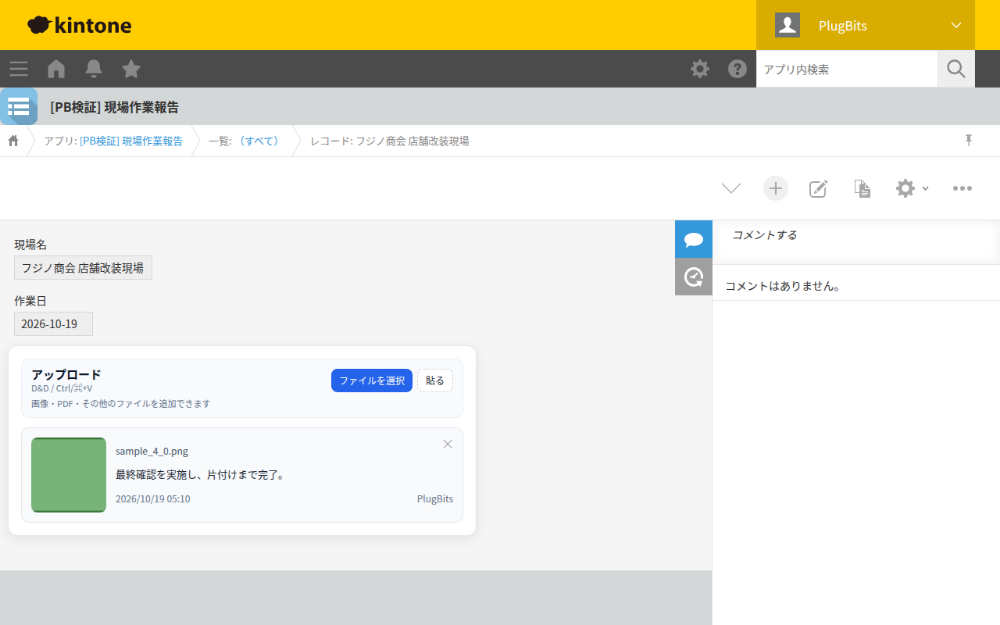

---

## 2. How This Plug-in Stores Data

This plug-in **saves each posted item as one row in a table (subtable)**.

Each time you post a file, one row is added to the table.

Each row mainly contains the following:

- Attachment
- Note
- Posted by
  - Optional
- Posted date/time
  - Optional

In other words, while it looks like a gallery, the data is actually stored in a table behind the scenes.

---

## 3. What to Prepare in Advance

Before using this plug-in, prepare the following in your kintone app.

### Required

- One table (subtable)
- One Attachment field inside the table
- One field for notes inside the table
  - Text, Text Area, or Rich Text
- One Space field
  - Used as the location where the upload area and gallery are displayed

### Optional

- A User Selection field inside the table
  - If you want the poster's name entered automatically
- A Date/Time field inside the table
  - If you want the post date/time entered automatically

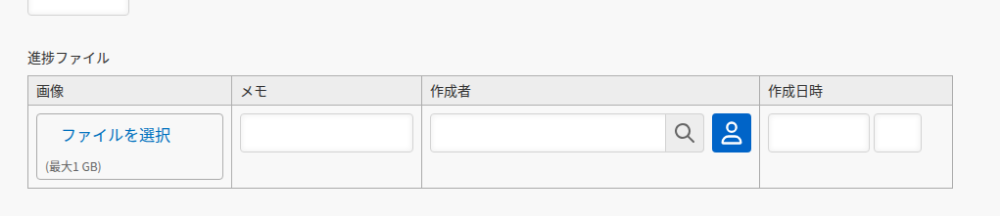

---

## 4. Initial Setup Steps

### 4-1. Upload the Plug-in

1. Open the app settings in kintone.
2. Open the Add Plug-ins screen.
3. Select and upload the zip file from the product page.
4. Add this plug-in to the app.

*Note: This section is explained in text rather than with a screenshot. Because uploading the zip file is done in kintone System Administration (which requires tenant-wide settings and System Administrator privileges), this screen cannot be safely reproduced using only a single app's test environment. The steps are as follows:*

1. Open kintone System Administration, go to the Plug-ins registration screen, and upload the zip file from the product page (only needed the first time).
2. In the target app, open "App Settings" → "Plug-ins" → "Add," which displays a list of plug-ins already registered to the tenant.
3. From the list, check "Sub-table Gallery Plugin" and click "Add."

### 4-2. Open the Plug-in Settings

From the plug-in list, open the settings screen for this plug-in.

When you open the settings screen, the app's field information is loaded first.

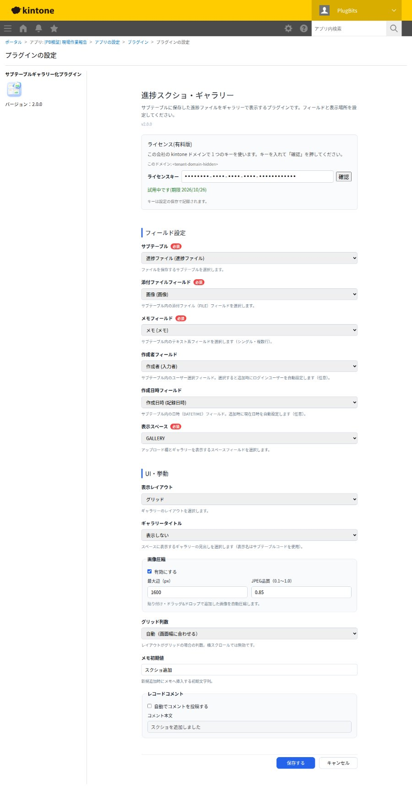

### 4-3. License (Trial and Purchase)

This is a paid plug-in. Check and register the key in the "License (Paid Version)" section at the top of the settings screen.

- **Trial**: Available once per kintone domain (company), for 14 days. Clicking the "Try free for 14 days" button automatically enters the key.
- **Registering a key**: Paste your purchased license key into the input field, click "Verify," and then save the plug-in settings. The key is recorded when the settings are saved.
- **For additional apps**: On the second and subsequent apps within the same kintone domain, you can use the plug-in without entering a key (once you verify the key or start the trial on any one app, the settings screen will show "Valid for this domain").
- **When expired or not registered**: If the trial period ends, or if no key has been registered, this plug-in's functionality will stop working. A notice bar will appear in the lower right of the screen, and the administrator should register the key from the plug-in settings screen.
- **Purchase**: Product page: https://plugbits.app/kintone/kintone-gallery/ (Checkout: https://buy.stripe.com/cNi3cx7Q31gu9gYgrH8so08)
- **Terms of Service**: https://plugbits.app/kintone/terms/

---

## 5. What Each Setting Means

### Field Settings

#### Table (subtable)

Select the table where files will be saved.

#### Attachment Field

Select the Attachment field inside the table.

Files you post will be saved here.

#### Note Field

Select the field used for notes inside the table.

This field stores a short description or comment for each post.

#### Created By Field

Set this only if needed.

When set, the name of the person who posted is entered automatically.

#### Created Date/Time Field

Set this only if needed.

When set, the date and time of the post are entered automatically.

#### Display Space

Specify the Space field where the upload area and gallery will be displayed.

- The upload area and gallery are displayed together in the specified space
- Setting a display space is required for this plug-in

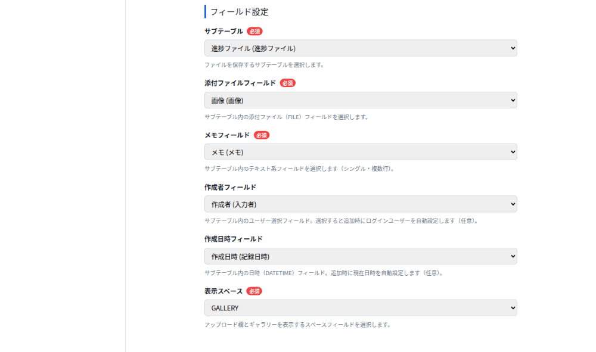

### UI and Behavior

#### Display Layout

Choose how the gallery is arranged.

- Grid
  - A standard list-style layout
- Horizontal scroll
  - Items flow horizontally

#### Gallery Title

Choose whether to display a heading for the gallery.

- Do not display
- Display the table (subtable) name

#### Image Compression

A setting that automatically reduces image file size.

- Enabled
  - Images are compressed before saving
- Disabled
  - Images are saved as-is, at their original size

"Max dimension" and "JPEG quality" let you adjust how much images are reduced in size.
In most cases, the default values work fine.

#### Number of Grid Columns

This setting applies only to grid layout.

- Auto
- Fixed at 2 columns
- Fixed at 3 columns

#### Default Note Text

Text that is automatically entered into the note field whenever a new file is posted.

Example: `Screenshot added`

#### Record Comment

Controls whether a comment is automatically posted to the record when a file is added.

- Off
  - No comment is posted
- On
  - A comment with the specified text is posted

Example: `A screenshot was added`

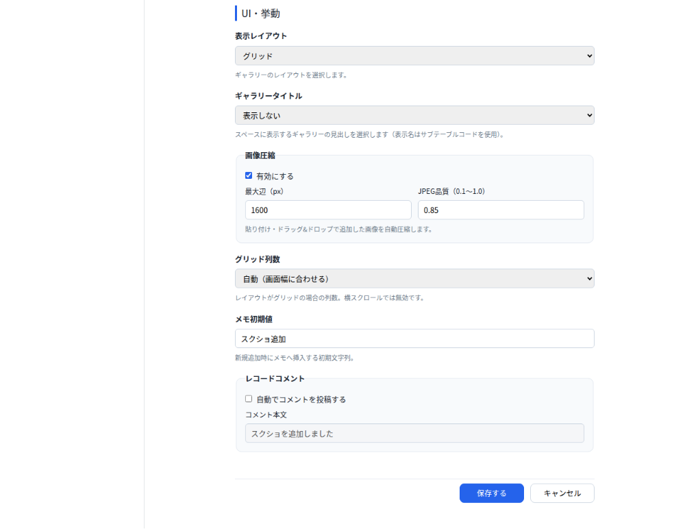

### Saving

Once you've finished configuring the settings, click "Save."
Afterward, don't forget to update the app as well.

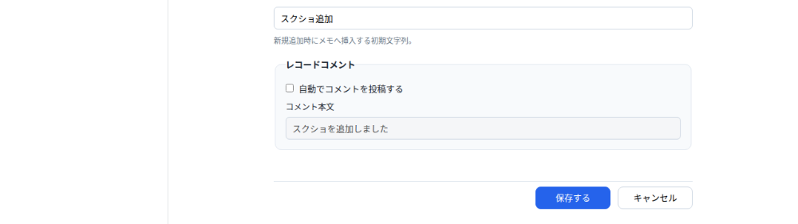

---

## 6. Everyday Usage

### 6-1. Opening the Detail Screen

When you open a record's detail screen, the following two elements are displayed:

- Upload area
- Gallery

The upload area is displayed as the very first card in the gallery.
The upload area and gallery are both displayed within the same Space field you configured.

### 6-2. Adding a File

There are three ways to add a file.

#### Method 1: Select a File

Post a file using the "Select File" button.

Images, PDFs, and other file types can all be added this way.

#### Method 2: Drag and Drop

Drag a file directly and drop it into the upload area.

Images, PDFs, and other file types can all be added this way.

#### Method 3: Copy and Paste

Paste into the upload area.

This method is **for pasting images only**.
It does not support pasting text-only content or non-image data.

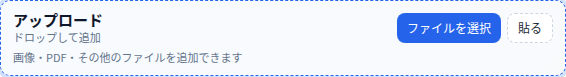

### 6-3. What Happens After Adding a File

When you add a file, the following happens automatically:

- A new row is added to the table (subtable)
- The default note text is entered
- If a "Posted by" field is set, it is filled in automatically
- If a "Posted date/time" field is set, it is filled in automatically
- If the comment setting is on, a comment is also automatically posted to the record

After adding a file, the screen reloads and the gallery updates to reflect the change.

---

## 7. Understanding the Gallery

In the gallery, each post is displayed as an individual card.

Each card mainly shows the following information:

- Thumbnail
- File name
- Note
- Posted date/time
- Posted by
  - Only shown if configured

Images are displayed at a reduced size.
PDFs and other file types are displayed with an icon indicating the file type.

---

## 8. Opening a File

Clicking a card's thumbnail opens a preview screen.

### For Images

- You can zoom in and out within the screen
- You can reset the view back to 100%
- You can open the image in a separate tab

### For PDFs

- You can view the file within the screen
- You can open the file in a separate tab

### For Other File Types

- In-screen preview is not supported
- Use "Open externally" to open the file

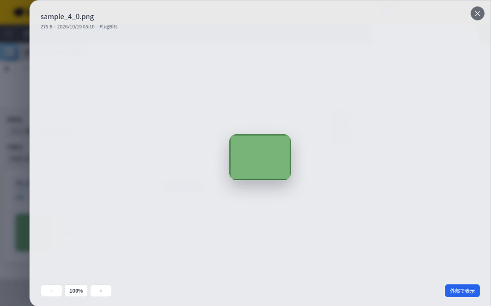

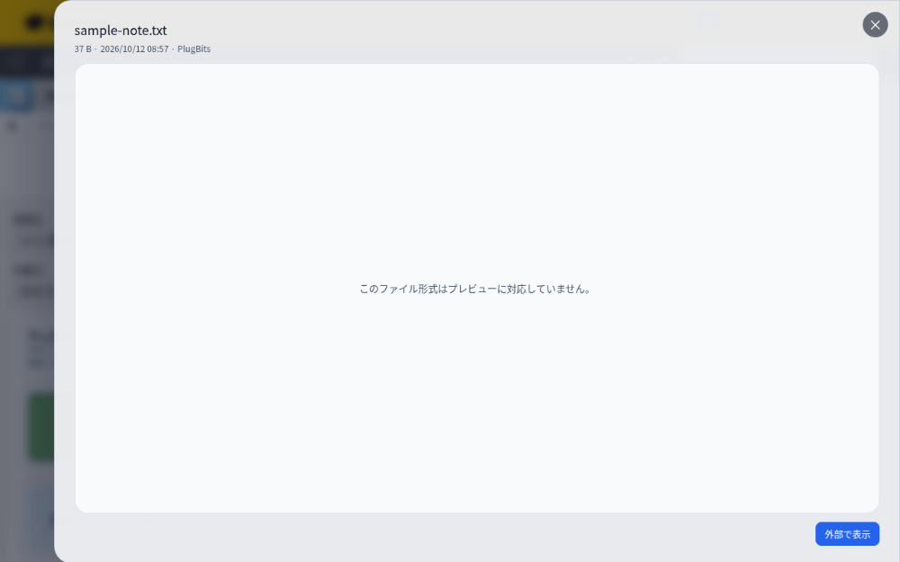

---

## 9. Editing a Note

Clicking a note lets you edit it in place.

- Enter key
  - Save
- Esc key
  - Cancel editing
- Clicking outside the input field
  - Save

If a note is empty, it displays as "No note entered."

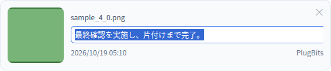

---

## 10. Deleting an Unneeded Post

You can delete a post using the `×` button in the upper right of each card.

A confirmation message appears before deletion.
When a post is deleted, the corresponding row in the table (subtable) is also deleted.

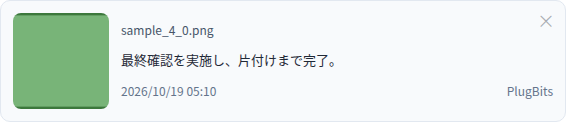

The delete confirmation dialog is the browser's standard confirmation popup (with the message "Delete this file?" and OK/Cancel buttons), so it does not appear in the screenshot. Clicking the × button displays this popup, and clicking OK carries out the deletion.

---

## 11. What Users See Without Edit Permission

If a user does not have edit permission for the record, the view becomes read-only.

In that case, the following actions are not available:

- Adding a file
- Editing a note
- Deleting a post

Only viewing the gallery is possible.

---

## 12. Operational Notes

### Copy-and-Paste Supports Images Only

Only images can be added via paste.
For PDFs and other file types, use file selection or drag-and-drop instead.

### Images May Be Automatically Reduced in Size

If image compression is enabled, images may be converted to JPEG format when saved.
If you need to preserve exact image quality or file size, review the compression setting.

### The Standard Table (Subtable) Is Used Behind the Scenes

This plug-in stores its data using a table (subtable), but on the detail screen it hides the standard table display and instead shows the content as an easy-to-view gallery.

---

## 13. Frequently Asked Questions

### Q. I posted a file, but I can't see it

Check the following:

- Whether the correct table (subtable) is selected in the plug-in settings
- Whether the Attachment field and Note field are configured correctly
- Whether the app has been updated
- Whether the Space field specified as the display space actually exists on the form

### Q. I can't paste

Check that you have actually copied an image.
Text-only copies or non-image data cannot be pasted.

### Q. "Posted by" or "Posted date/time" isn't being filled in

Check that the corresponding fields are configured in the plug-in settings.
For the posted date/time, a Date/Time field must be specified.

### Q. Comments aren't being posted automatically

Check that the Record Comment setting is turned on.

---

## 14. Recommended Settings for Administrators

If you're unsure where to start, we recommend the following settings:

- Display Layout: Grid
- Number of Grid Columns: Auto
- Image Compression: Enabled
- Default Note Text: `Screenshot added`
- Record Comment: Turn on if needed

---

## 15. Summary

This plug-in is designed to let you quickly add progress-tracking files from the detail screen and have them automatically organized into an easy-to-view layout.

It is especially well suited for the following use cases:

- Recording on-site photos
- Sharing screenshots of work progress
- Attaching PDFs and supplementary reference materials
- Simple evidence tracking at the individual record level
