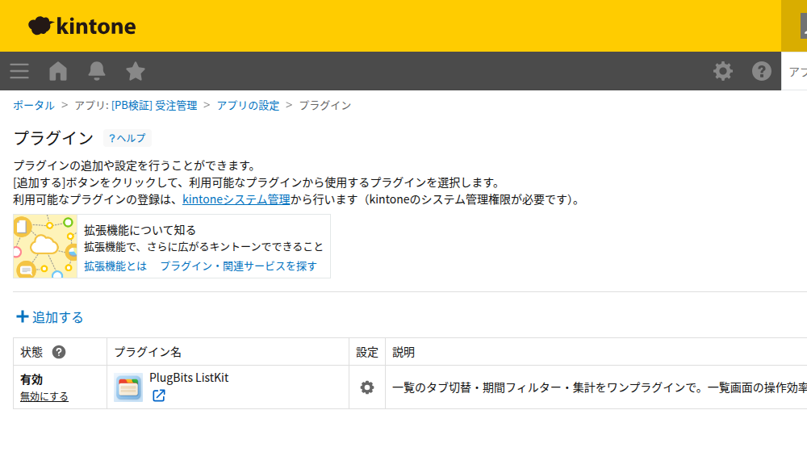
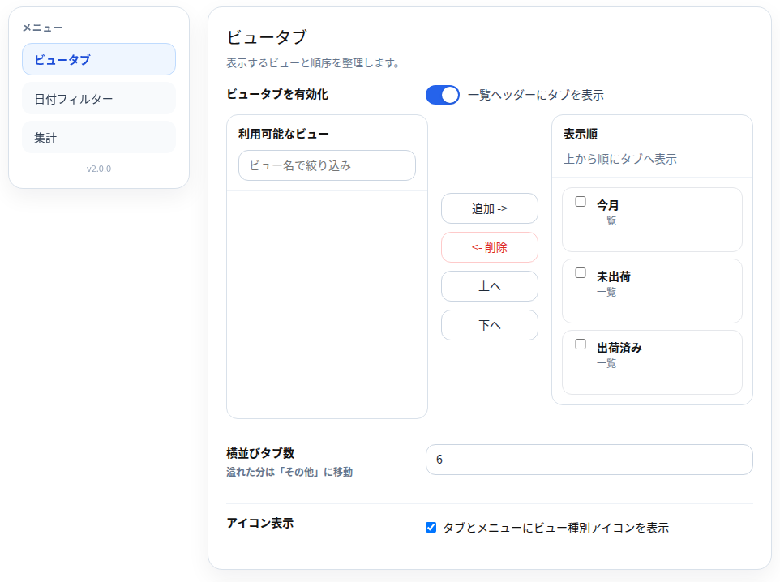
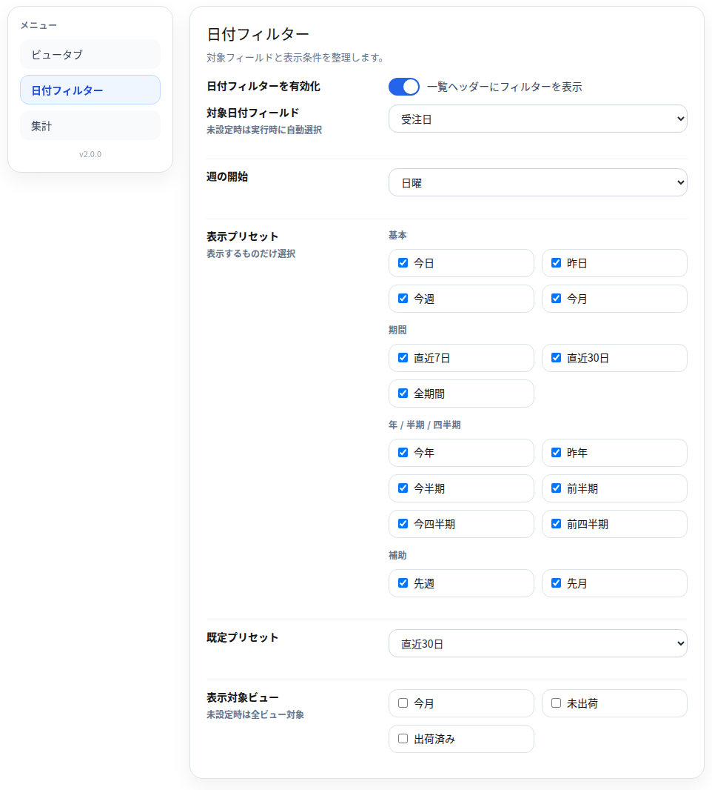
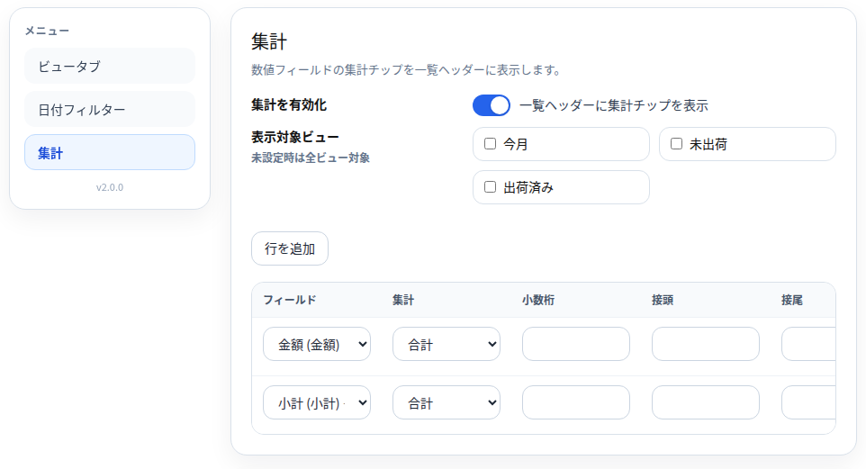
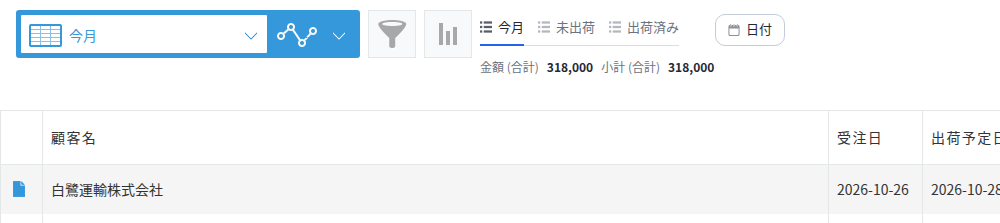
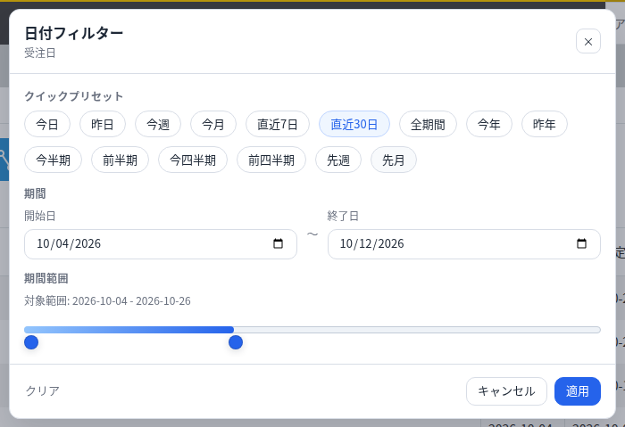
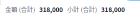

## 1. できること

このプラグインは、kintone の一覧画面に次の機能を追加します。

- ビュータブ
- 日付フィルター
- 集計表示

## 2. 設定画面の開き方

1. 対象アプリを開きます。
2. アプリ設定を開きます。
3. プラグイン設定で `PlugBits ListKit` を開きます。

## 3. ビュータブ

`ビュータブを有効化` をオンにすると、一覧上部にビュー切替タブを表示します。

- `利用可能なビュー`
  - タブに出せるビューの一覧です。
- `表示順`
  - 実際に表示するビューの一覧です。
- `追加 ->`
  - 選んだビューを表示対象に追加します。
- `<- 削除`
  - 表示対象から外します。
- `上へ / 下へ`
  - タブの順番を変更します。
- `横並びタブ数`
  - 画面に直接出すタブ数です。超えた分は `その他` に入ります。
- `アイコン表示`
  - ビュー種別のアイコンを表示します。

## 4. 日付フィルター

`日付フィルターを有効化` をオンにすると、一覧上部に日付フィルターを表示します。

- `対象日付フィールド`
  - 絞り込みに使う日付または日時フィールドです。
- `週の開始`
  - `今週` `先週` の基準です。
- `表示プリセット`
  - 利用者に表示する期間ボタンを選びます。
- `既定プリセット`
  - 最初に選ばれる期間です。
- `表示対象ビュー`
  - 日付フィルターを表示するビューを選びます。未選択なら全ビューです。

## 5. 集計

`集計を有効化` をオンにすると、一覧上部に集計結果を表示します。

- `表示対象ビュー`
  - 集計を表示するビューを選びます。未選択なら全ビューです。
- `行を追加`
  - 集計ルールを追加します。

各行で設定する内容:

- `フィールド`
  - 集計する数値フィールドまたは計算フィールド
- `集計`
  - 合計 / 平均 / 最小 / 最大 / 件数
- `小数桁`
  - 小数点以下の表示桁数
- `接頭`
  - 数字の前に付ける文字
- `接尾`
  - 数字の後に付ける文字

## 6. 一覧画面での使い方

### ビュータブ

- タブをクリックするとビューを切り替えます。
- タブが多い場合は `その他` から選びます。

### 日付フィルター

1. `日付` をクリックします。
2. 期間を選ぶか、開始日と終了日を入力します。
3. `適用` を押します。
4. 条件を外すときは `クリア` を押します。

### 集計

- 一覧上部に設定した集計結果が表示されます。
- 表示内容は、現在のビューと絞り込み条件に応じて変わります。

## 7. よくある確認ポイント

### 日付フィルターが出ない

- `日付フィルターを有効化` がオンか
- 対象ビューに含まれているか
- 日付または日時フィールドがあるか

### 集計が出ない

- `集計を有効化` がオンか
- 集計ルールが 1 行以上あるか
- 数値または計算フィールドを選んでいるか

### 動作が重い

- 集計対象のビューを減らす
- 集計行を減らす
- 必要に応じて集計をオフにする

## 8. 保存前のチェックと保存後の案内

設定画面は、保存しても動かない組み合わせをあらかじめ防ぎます。次のような場合は保存がブロックされ、該当欄の近くに赤字でメッセージが表示されます。

- `ビュータブを有効化` がオンなのに、`表示順` にビューが 1 件もない
- `日付フィルターを有効化` がオンなのに、このアプリに日付/日時フィールドが無い、または `表示プリセット` が 1 件も選ばれていない
- `集計を有効化` がオンなのに、集計ルールが 1 行もない、またはアプリに存在しないフィールドを参照しているルールがある

これらを直すまで `保存` は完了しません。問題が無ければ保存が実行され、`保存しました。アプリの設定画面で「アプリを更新」を押すと一覧に反映されます。` という案内が保存ボタンの下に表示されます。表示どおり、保存後は対象アプリの設定画面右上の `アプリを更新` を押すまで、一覧側の表示は変わりません。

- 一覧件数が多い場合、集計表示に時間がかかることがあります。

## 9. 動作環境・対応版

- 動作環境: PC のブラウザ(Chrome/Edge 最新版)専用です。kintone モバイル(スマホアプリ・モバイル版画面)には対応していません。
- 対応版: 2.0.0

## 10. ライセンス(試用と購入)

- 有料プラグインです。設定画面の `ライセンス(有料版)` 欄にキーを入力して保存すると使用できます。
- キー未入力の状態でも、同じ kintone ドメインにつき 1 回・14 日間の試用ができます。試用開始後は設定画面に残り日数が表示されます。
- 試用期限が切れている、またはキーが未登録・無効な場合は、ビュータブ・日付フィルター・集計のすべての機能が停止します。このとき一覧画面の右下に案内が表示されます。
- 購入ページ: https://plugbits.app/kintone/kintone-listkit/
- 利用規約: https://plugbits.app/kintone/terms/
