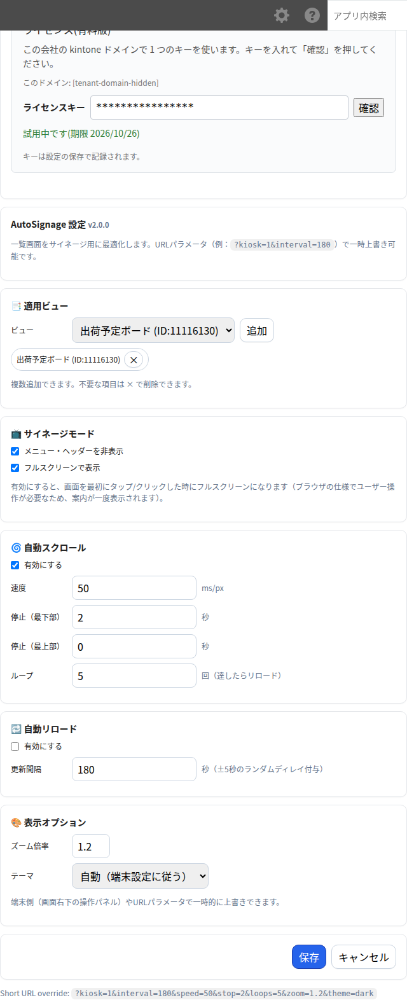
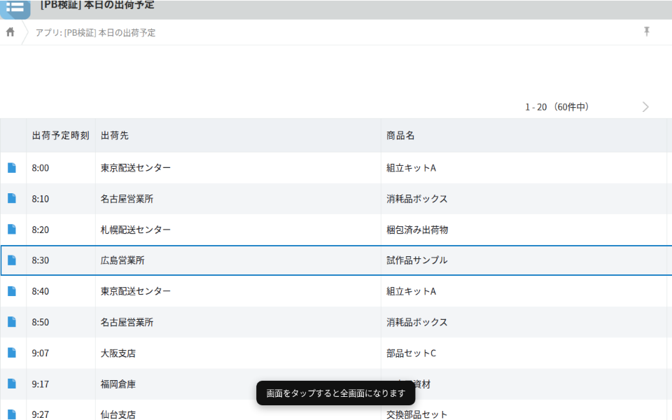
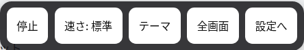
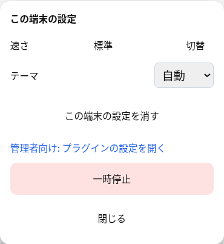

**対応版:** 2.0.0
**動作環境:** PC のブラウザ(Chrome/Edge 等)。サイネージ用の大型画面・キーボード無しの端末(タッチ操作)での運用を想定しています。kintone モバイル(スマホアプリ・モバイル版画面)には対応していません(モバイル向けのスクリプトを持たないため、モバイルでは機能自体が動きません)。

## 1. できること

このプラグインは、kintone の一覧画面をサイネージ(壁掛けディスプレイ・キオスク端末)用に最適化します。

- メニュー・ヘッダーなどを非表示にするサイネージモード
- 画面の自動スクロール・自動リロード
- テーマ(ライト/ダーク/自動)とズーム倍率
- フルスクリーン表示
- 画面右下の操作帯(タップ操作用の5ボタン)と、端末ごとの速さ・テーマ設定

## 2. 設定画面の開き方

1. 対象アプリを開きます。
2. アプリ設定を開きます。
3. プラグイン設定で `AutoSignage for Kintone` を開きます。

## 3. ライセンス(試用と購入)

設定画面の最上部に、ライセンス欄があります。

- **試用:** `14日間 無料で試す` ボタンで開始できます。試用は kintone ドメインごとに1回・14日間です。ボタンを押すとキーが自動で入るので、そのまま設定を保存してください。
- **購入したキーをお持ちの場合:** キー欄に入力し、`確認` で状態を確認してから設定を保存すると有効になります。
- 試用期間が終わった後、またはキーが未登録/期限切れの場合は、一覧は通常表示のまま動作せず(自動スクロール・自動リロード・ヘッダー非表示などは一切動きません)、画面右下に案内が表示されます。
- 購入ページ: https://plugbits.app/kintone/kintone-signage/(購入の手続き: https://buy.stripe.com/14A5kF8U77ES1Owb7n8so05)
- 利用規約: https://plugbits.app/kintone/terms/

## 4. 対象ビューの設定

`📑 適用ビュー` カードで、サイネージを動かすビューを追加します。

- ビューを選んで `追加` を押すと一覧に追加されます。複数追加できます。
- 追加した項目の `×` で削除できます。
- **ビューを1つも追加していない場合は、すべての一覧ビューでサイネージが動作します。** 特定のビューだけに絞りたい場合に、ここで指定してください。

## 5. サイネージモード・フルスクリーン

`📺 サイネージモード` カードで設定します。

- `メニュー・ヘッダーを非表示`: kintone のグローバルヘッダー・アプリのタイトルバー・一覧のコメント欄・下部ステータスバー・レコード追加やアプリ設定などのツールバーボタンを非表示にします。
- `フルスクリーンで表示`: 有効にすると、画面を最初にタップ/クリックした時にフルスクリーンになります。ブラウザの仕様でユーザー操作が必須のため、最初に「画面をタップすると全画面になります」という案内が一度だけ表示されます。

## 6. 自動スクロール

`🌀 自動スクロール` カードで設定します。

- `有効にする`: オンで一覧を自動的に下方向へスクロールします。
- `速度`: 数値が小さいほど速くスクロールします(ミリ秒/px、既定値50)。なお画面右下の操作帯/端末設定パネルの「速さ」は、遅い・標準・速い の3段階をあらかじめ決まった値で順に切り替えるボタンです。
- `停止(最下部)`: 最下部まで到達した後、先頭へ一瞬で戻るまでの待ち時間(秒)。
- `停止(最上部)`: 先頭へ戻った後、再びスクロールを始めるまでの待ち時間(秒)。
- `ループ`: 最下部到達を何回繰り返したら画面をリロードするか。
- サイネージモードが有効な状態で自動スクロールも有効にすると、来場者が手(タッチ・マウスホイール・キー操作)でスクロールを動かせないようにロックします。サイネージモードを使わずに自動スクロールだけ有効にした場合は、手動スクロールはロックされません。

## 7. 自動リロード

`🔁 自動リロード` カードで設定します。

- `有効にする` をオンにし、`更新間隔`(秒)を指定します。実際の間隔には ±5秒のランダムなずれが付きます(複数端末が同時にリロードしてサーバーへ負荷が集中するのを避けるため)。
- 自動リロードは、操作帯や端末設定パネルが開いていても、一時停止中であっても、設定した時刻になれば必ず実行されます。リロード後は通常の再生状態(一時停止なし)に戻ります。

## 8. 表示オプション(テーマ・ズーム)

`🎨 表示オプション` カードで設定します。

- `ズーム倍率`: 画面全体の拡大率です(0.5〜2.0)。
- `テーマ`: `自動`(端末の prefers-color-scheme に追従)/`ライト`/`ダーク` から選べます。一覧の背景・文字色・縞模様・ヘッダー色が切り替わります(表形式の一覧のみ。カレンダー/カスタムビューには適用されません)。
- これらは画面右下の操作帯・端末設定パネルや、URLパラメータ(例: `?kiosk=1&interval=180&speed=50&stop=2&loops=5&zoom=1.2&theme=dark`)で一時的に上書きできます。

## 9. 画面右下の操作帯(キーボード無し端末向け)

一覧画面の右下 96×96 の範囲をタップ/クリックするか、マウスを意味のある距離(8pxを超えて)動かすと、5つのボタンが並んだ操作帯が表示されます。操作が無ければ5秒で自動的に隠れます。

- `停止`/`再開`: 自動スクロールの一時停止・再開を切り替えます(Shift+Escと同じ動作)。
- `速さ: 標準`: 速さを 遅い→標準→速い の3段階で順に切り替えます。この端末だけに保存されます。
- `テーマ`: ライト/ダークを切り替えます。この端末だけに保存されます。
- `全画面`: フルスクリーン表示のオン/オフを切り替えます。
- `設定へ`: **長押し(約1秒)** でこの端末の設定パネルを開きます。ボタンに進捗バーが表示され、長押しの進み具合が分かります。PINコードなどの入力は不要です。

## 10. 端末ごとの設定

`設定へ` を長押しすると、この端末だけの設定パネルが開きます。

- `速さ`: 切替ボタンで3段階を順に切り替えます。
- `テーマ`: 自動/ライト/ダーク をプルダウンで選べます。
- `この端末の設定を消す`: この端末に保存した速さ・テーマの設定を削除し、画面をリロードします(管理者側のプラグイン設定には影響しません)。
- `管理者向け: プラグインの設定を開く`: 管理者向けのプラグイン設定画面を新しいタブで開きます。
- `一時停止`(一時停止中は `再開`): 一時停止/再開を切り替えます(「停止」ボタン・Shift+Esc と同じ動作です)。英語表示では `Pause` / `Resume`。
- `閉じる`: このパネルを閉じます。

**保存先:** 速さ・テーマはブラウザの localStorage に、アプリごとの名前空間(`pb_signage_<アプリID>`)で保存されます。**この端末・このブラウザだけに保存**され、他の端末には反映されません。他の端末にも同じ設定を反映したい場合は、管理者側のプラグイン設定を変更してください。

**設定の優先順位:** プラグイン設定(管理者) < この端末の設定 < URLパラメータ(URLパラメータが常に最優先)。ただし端末側で上書きできるのは「速さ」と「テーマ」のみです。

## 11. サイネージの終了方法

- キーボードがある場合: `Shift+Esc` で一時停止⇔再開を切り替えられます。
- キーボードが無い端末: 操作帯の `設定へ` を長押し→端末設定パネルの `一時停止` を押します(Shift+Esc と同じ動作です)。

「一時停止」は、画面を一時停止した状態に戻す操作で、別の画面に移動するものではありません。一時停止すると自動スクロールが止まり、サイネージモードで隠していたヘッダーやツールバー・一覧の配色も元の表示に戻ります。**自動リロードだけは一時停止中でも設定した間隔のまま動き続け**、リロード後は通常のサイネージ再生に戻ります。完全に離れたい場合は、ブラウザで別の画面に移動するか、タブ/ブラウザを閉じてください。

## 12. よくある確認ポイント

### フルスクリーンにならない

- ブラウザの仕様上、フルスクリーンにはユーザー操作(タップ/クリック)が必須です。案内が表示された後、画面を一度タップ/クリックしたか確認してください。
- ブラウザや環境によってはフルスクリーンAPIが使えない/ブロックされることがあります。

### サイネージが動かない(通常の一覧表示のまま)

- ライセンスが未登録または期限切れの可能性があります。画面右下の案内を確認し、プラグイン設定でキーを登録するか試用を開始してください。

### 特定のビューで動かない

- `適用ビュー` に対象のビューが追加されているか確認してください。1つも追加していなければ全ビューで動作するはずです。

### スクロールが止まっている/動かない

- `自動スクロールを有効にする` がオンか確認してください。
- 一覧の件数が少なくスクロールの必要が無い場合は、そもそも動きません(正常です)。

### 縞模様・ヘッダーの配色が変わらない

- 配色機能は表形式の一覧のみ対応です。カレンダービュー・カスタムビューには適用されません。

### 操作帯が出てこない

- 画面右下 96×96 の範囲をタップするか、マウスを意味のある距離(8pxを超えて)動かしてください。わずかな揺れ(ジッター)では表示されません。

### この端末で変えた設定が他の端末に反映されない

- 速さ・テーマの端末設定は、その端末のブラウザ(localStorage)にのみ保存される仕様です。他の端末にも反映したい場合は、管理者側のプラグイン設定を変更して保存してください。

## 13. 注意

- グローバルヘッダー・アプリタイトルバー・コメント欄・下部ステータスバーの非表示は、公式APIが無いため kintone 内部の DOM 構造(クラス名・ID)に依存している部分があります。kintone 側の実装が変わると、その部分の非表示だけが効かなくなることがありますが、他の機能(スクロール・リロード・操作帯・テーマ配色など)は影響を受けず動作を続けます。
- ツールバーボタン(レコード追加/アプリ設定/絞り込み/オプション/集計/一覧とグラフの選択/アプリの説明)の非表示は、2025-08-10 以降の kintone 公式API が前提です。それ以前の環境では該当ボタンの非表示だけがスキップされます。
- 画面スリープ防止(Wake Lock)は対応ブラウザでのみ有効です。非対応の環境では何も行わず、端末の通常のスリープ設定に従います。
- 設定変更後は `保存` を押すとアプリ設定画面へ自動的に戻ります。
