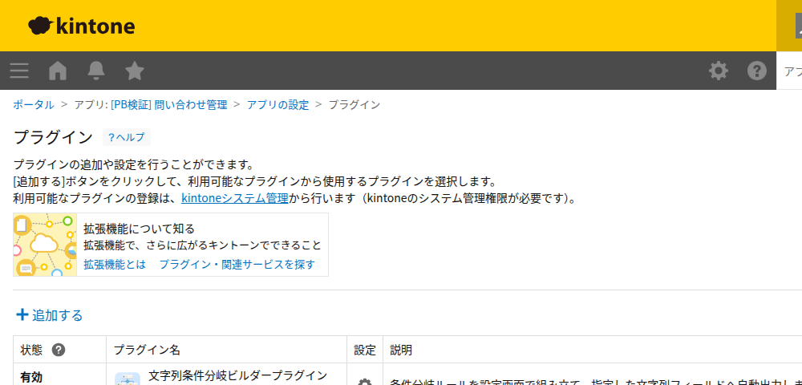
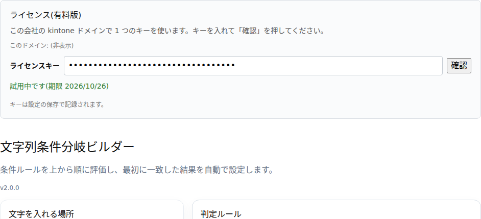
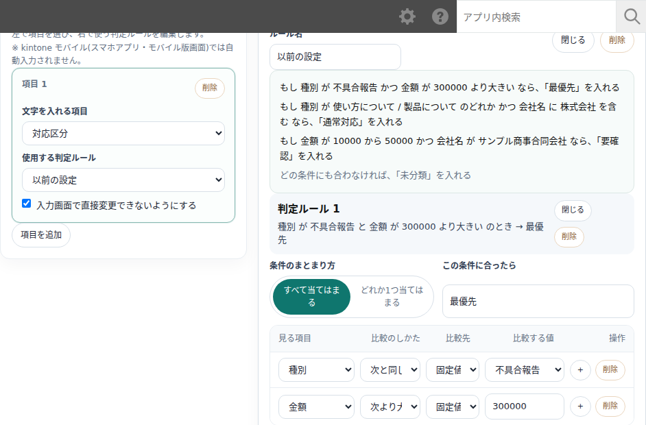
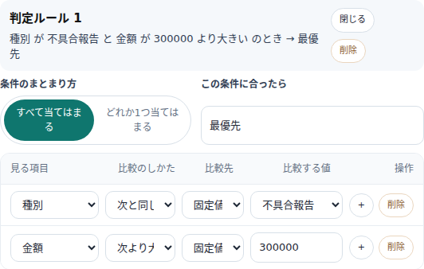
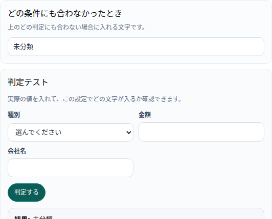
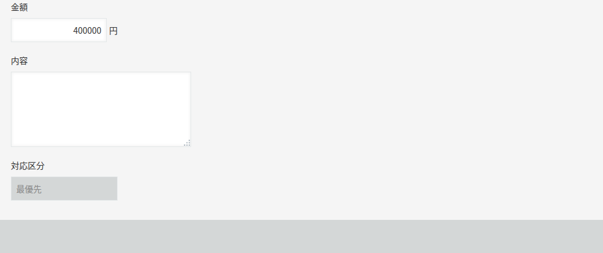

## 1. できること

このプラグインは、レコードの値を見て条件に合わせた文字を、指定した文字列（1行テキスト）項目に自動で入れます。

- 条件（例:「種別が不具合報告」「金額が30万より大きい」）を上から順に並べ、最初に当たったルールの文字を出力します。
- 比較する値は固定の文字・数値だけでなく、他の項目の値や数式（数値項目のみ）も使えます。
- 出力先の項目は複数作れます。項目ごとに使う判定ルールを選べます。
- 出力先の項目を、入力画面で直接書き換えられないようにロックできます。
- 保存前に、実際の値を入れて判定結果を試せます（判定テスト）。

## 2. 設定画面の開き方

1. 対象アプリ（本マニュアルではアプリ「問い合わせ管理」）を開きます。
2. 右上の「アプリ設定」を開きます。
3. 左側メニューの「プラグイン」から `文字列条件分岐ビルダープラグイン` を選びます。

## 3. 文字を入れる項目の設定

設定画面の上から順に、ライセンス欄 → タイトル・版番号 → 「文字を入れる場所」（左側）→「判定ルール」（右側）が並びます。

- `項目を追加`
  - 文字を自動で入れる項目を1つ追加します。選べるのは、アプリの**1行テキスト項目のみ**です（数値・日付・ラジオボタンなどには出力できません）。
- `文字を入れる項目`
  - 自動入力の出力先です。同じ項目は1つの設定内で1回しか選べません。
- `使用する判定ルール`
  - この項目にどの判定ルールを当てるかを選びます。「新しい判定ルールを作る」を選ぶと、新しい判定ルールセットが作られます。複数の項目が同じ判定ルールを共用することもできます。
- `入力画面で直接変更できないようにする`（出力欄のロック）
  - オンにすると、新規作成・編集画面でこの項目が読み取り専用になり、判定結果だけが入ります。利用者が手で書き換えることはできません。**既定はオンです。**
  - オフにすると、画面上は編集できますが、値を変えて保存したあとに再度この画面を開く・編集を保存すると、判定結果で上書きされます。
- 項目を削除するときは、カードの `削除` を押します。

> 文字を入れる項目そのものは、判定ルールの条件や数式の中で参照できません（保存時にエラーになります）。

## 4. 判定ルールの作り方

ここで「判定ルールセット」（条件のまとまり）を作ります。1つの判定ルールセットの中には、複数の「判定ルール」（条件の行）を順番に並べられます。

- `ルール名`
  - 判定ルールセットの名前です（省略可）。
- `判定ルールを追加`
  - 新しい条件の行を1つ追加します。追加した順（上から下）に評価されます。

各「判定ルール」の中で設定する内容:

- `条件のまとまり方`
  - `すべて当てはまる`（AND）: 行内のすべての条件に合ったときだけ一致します。
  - `どれか1つ当てはまる`（OR）: 行内のどれか1つの条件に合えば一致します。
- 条件の行（`見る項目` / `比較のしかた` / `比較先` / `比較する値`）
  - `見る項目`: 条件に使うアプリの項目です。数値・1行テキスト・ラジオボタン・ドロップダウン・日付・日時・計算（数値扱い）が選べます。
  - `比較のしかた`: 項目の型によって選べる比較方法が変わります（一覧は次節）。
  - `比較先`: 比較する値をどこから取るかです。
    - `固定値`: その場に入力した値と比較します。
    - `他の項目`: 同じ画面の別の項目の値と比較します（項目の型が合うものだけ選べます）。
    - `数式`: 数値項目だけを使った計算式（例: `[unit_price] * [quantity]`）の結果と比較します。数式では `[項目コード]` の形で数値項目を書きます。四則演算と括弧が使えます。
  - `比較する値`: 比較方法・比較先に応じた値の入力欄です。
  - 行の `+` でその下に条件を追加、`削除` でその行を削除します（最後の1行は削除すると自動で空の行に戻ります）。
- `この条件に合ったら`
  - この判定ルールに一致したときに出力する文字です。
- 判定ルールの `閉じる/開く` で行の表示を折りたためます。`削除` でその判定ルール自体を削除します（最後の1つを消すと自動で空の判定ルールに戻ります）。

### 評価の順番とどれにも当たらないとき

- 判定ルールは**上から順に**評価し、**最初に一致したルール1つだけ**の出力を使います（下にある、より条件が狭いルールでも、上のルールに先に当たれば使われません）。優先させたい判定ルールは上に置いてください。
- どの判定ルールにも当たらなかった場合は、「どの条件にも合わなかったとき」に入力した既定の文字を出力します（未入力なら空欄になります）。

## 5. 比較方法（演算子）の一覧

項目の型ごとに選べる比較方法です。

- **数値・計算項目**: 次と同じ / 次と違う / 次より大きい / 次以上 / 次より小さい / 次以下 / この範囲 / この範囲以外 / 空欄 / 空欄ではない
- **1行テキスト**: 次と同じ / 次と違う / 次を含む / 次を含まない / 次で始まる / 次で終わる / 空欄 / 空欄ではない
- **ラジオボタン・ドロップダウン**: 次と同じ / 次と違う / 次のどれか / 次のどれでもない / 空欄 / 空欄ではない
- **日付・日時**: 次と同じ / 次と違う / 次より前 / 次より後 / 今日 / 昨日 / 明日 / 前後の日数内 / 指定日数より前 / 空欄 / 空欄ではない

「他の項目」「数式」で比較できるのは、型が合う組み合わせだけです（数値どうし、文字どうし、日付と日時はどちらも可、ラジオボタン・ドロップダウンは「次と同じ/次と違う」のときだけ）。「空欄」「空欄ではない」や「今日/昨日/明日」などは比較先を使いません。

## 6. 判定テスト

(画像は4節と共通です)

判定ルールセットの一番下にある「判定テスト」で、保存前に動きを確かめられます。

1. 条件に使っている項目の値を入力します。
2. `判定する` を押します。
3. 「結果」（出力される文字）・「一致した判定ルール」・「理由」が表示されます。

条件の内容を変えると、結果は自動でクリアされます（もう一度「判定する」を押してください）。この判定テストは設定画面の中だけの確認で、実際のレコードは変更しません。

## 7. 入力画面での使い方

設定を保存してアプリを更新すると、対象アプリの**新規作成画面・編集画面**で動作します。

- 画面を開いたとき、条件に使っている項目の現在値に応じて、出力先の項目に判定結果が自動で入ります。
- 条件に使っている項目の値を変えると、その場で出力先の項目が再計算されます。
- 保存（登録・更新）するときにも、最終的な値で一度再計算してから保存します。
- 出力欄をロックしている場合、その項目はグレー表示になり、手で入力できません。
- 一覧画面やレコード詳細（閉じた状態の表示画面）では動作しません。値は作成・編集時に決まったものがそのまま表示されます。

## 8. よくある確認ポイント

### 出力先の項目に文字が入らない

- アプリ設定を保存したあと、「アプリを更新」を押して本番に反映したか
- 「文字を入れる項目」に選んだ項目が、確認したい入力画面に配置されているか
- 条件に使っている項目の値が、想定した判定ルールの条件に合っているか（判定テストで確認できます）
- ライセンス（下記9参照）が有効か。期限切れ・未登録だと動作が止まります

### 想定と違う文字が入る

- 判定ルールは上から順に評価され、最初に当たったものだけが使われます。意図したルールより上に、先に当たってしまうルールがないか確認してください

### kintone モバイルで自動入力されない

- 本プラグインは PC のブラウザ専用です。kintone モバイル（スマホアプリ・モバイル版画面）では自動入力は動きません（9. 動作環境を参照）

### 保存時にエラーが出る

- 「文字を入れる項目そのものは条件や比較式に使えません」: 出力先に選んだ項目を、別の判定ルールの条件や数式で参照していないか確認してください
- 数式に関するエラー: `[項目コード]` の書き方や、参照している項目が数値項目かどうかを確認してください

## 9. 動作環境

PC のブラウザ（Chrome/Edge 最新版）。kintone モバイル（スマホアプリ・モバイル版画面）は非対応です。モバイルでは出力先の項目は自動入力されません。

## 10. 対応版

対応版: 2.1.0

## 11. ライセンス（試用と購入）

設定画面の上部にライセンス欄があります。

- 試用は kintone ドメイン（会社）ごとに **14日間・1回だけ**利用できます。`14日間 無料で試す` を押すとキーが自動で入ります。
- 購入したキーをお持ちの場合は、キーを入力して `確認` を押し、保存してください。
- 同じ kintone ドメインの 2 つ目以降のアプリでは、キーを入れなくても使えます(どれか 1 つのアプリでキーを確認するか試用を始めれば、設定画面に「このドメインで有効です」と出ます)。
- 試用期間が終わる、またはキーが未登録・無効な場合、機能が停止し、画面右下に案内が表示されます。管理者はこの設定画面からキーを登録してください。
- 購入ページ: https://plugbits.app/kintone/kintone-rule-builder/(購入の手続き: https://buy.stripe.com/aFadRb1rF3oCcta4IZ8so06)
- 利用規約: https://plugbits.app/kintone/terms/

## 12. 注意

- 設定を変更したら、「保存する」のあと、アプリ設定の「アプリを更新」を押さないと本番の画面には反映されません。
- 出力先の項目は1行テキスト項目のみです。数値・日付・選択系の項目には出力できません。
- 条件や数式で参照する項目の型は、比較する値の型と合わせる必要があります（型が違う項目は選べないようになっています）。
